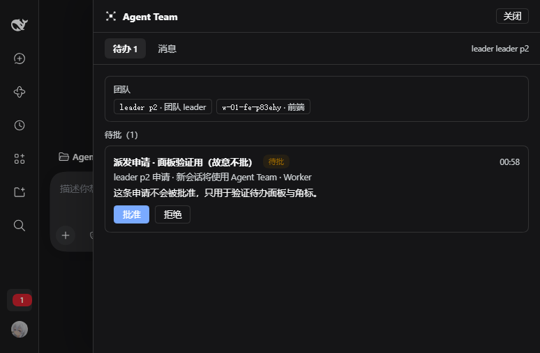
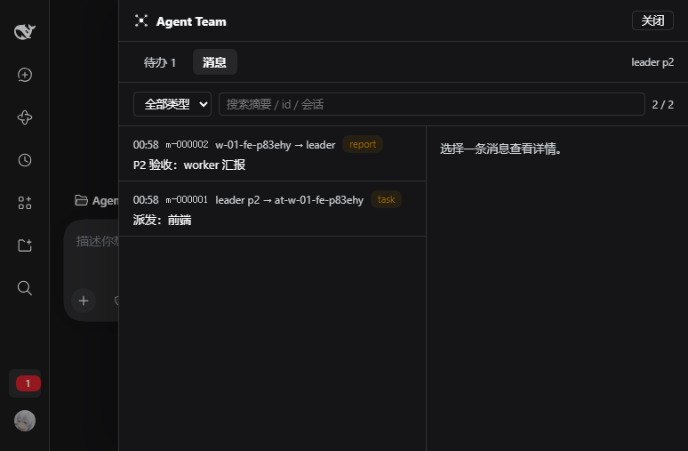
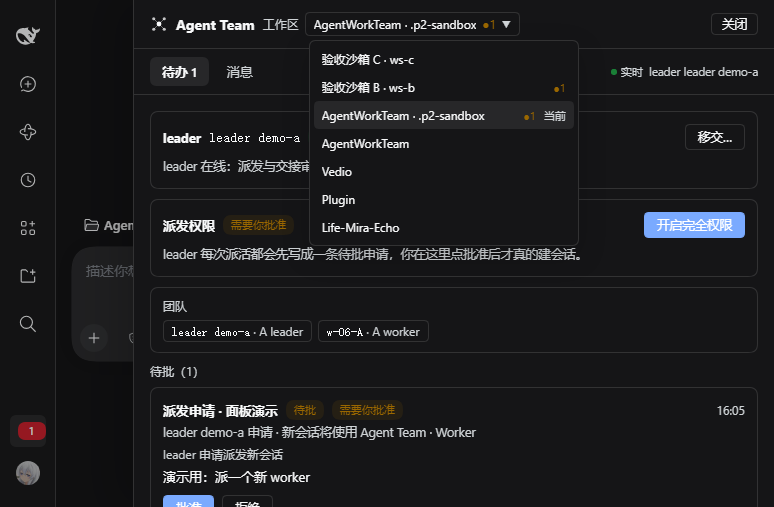
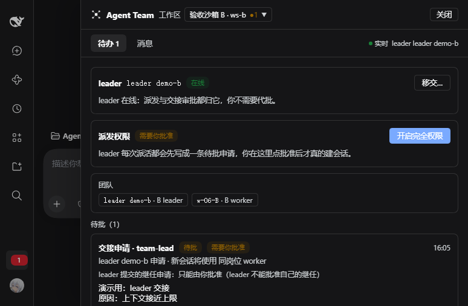

# 正式前端（侧边栏 + 抽屉）实测记录

> 结论：**可用**（两个标签页、代批主路径走通）；规格里三处分项未做，见 §4
> 实测时间：2026-11-21 01:00（Asia/Shanghai）
> 环境：独立 `p2-test` profile，DSH `0.2.2-rc.5`，宿主 `http://127.0.0.1:55580`
> 截图：[待办页](./assets/agent-team-drawer-pending.png) · [消息页](./assets/agent-team-drawer-messages.png)

---

## 1. 落地形态

| 槽位 | 用途 | 实测 |
|---|---|---|
| `sidebar.footer.action` | 侧边栏底部按钮，有待办时显示红色角标数字；有未读新消息时显示小圆点 | 截图中角标为 **1** |
| `shell.overlay` | 右侧抽屉，两个标签页（待办 / 消息），Esc 与「关闭」都能收起 | 截图 |

数据全部来自同源的 `/agent-team/*`（loopback only），面板**不碰会话**、不改任何已读游标。

## 2. 待办页



- 顶部「团队」卡：岗位表（`leader p2 · 团队 leader`、`w-01-fe-p83ehy · 前端`）。
- 「待批（1）」：类型、岗位、申请人、申请时间、申请正文、**批准 / 拒绝**。
- 拒绝走二次输入（可填原因），批准是主路径、一次点击。

## 3. 消息页



- 类型筛选 + 摘要 / id / 会话搜索，右侧详情按需加载正文。
- 每行显示：时间、消息 id、`发送方 → 收件人表达式`、类型、摘要；有投递失败时加红标。
- 详情显示解析后的收件人与每个收件人的投递状态。

## 4. 逐条对照 `panels.md` §7 的验收判据

| # | 判据 | 结果 | 说明 |
|---|---|---|---|
| 1 | 待办可见、角标正确 | **PASS** | 截图角标 1；`/agent-team/state` 的 `pending.length` |
| 2 | 代批生效 | **PASS（实测）** | 界面点「批准」后：`pending 1 → 0`，新会话 `at-w-02-demo-83ewu` 出现在岗位表，新增一条 `task` 消息 |
| 3 | 不误批（并发只生效一次） | **部分** | 非 pending 状态再批会报 `申请不是待批状态`；并发压测没做 |
| 4 | 消息可见、收件人与投递正确 | **PASS** | 截图中 2 条消息，投递状态来自 store |
| 5 | 正文按需加载 | **PASS** | 列表只带摘要；点开走 `/agent-team/body?id=` |
| 6 | 筛选与搜索 | **PASS** | 四个筛选（类型 / 收件人 / 时间 / 投递状态）+ 摘要·id·会话搜索，可叠加、可清空（2026-11-21 补）|
| 7 | 实时 | **PASS** | `/agent-team/events` SSE 实时推送；连上即停轮询，断流退回 3 秒轮询，标题栏小圆点显示「实时/轮询」（2026-11-21 补）|
| 8 | 只读 | **PASS** | 无编辑 / 删除 / 撤回 / 代发 / 导出 |
| 9 | 持久 | **PASS** | 状态落 `store.json`，重启后仍在 |

## 5. 与规格的偏差（必须知道）

1. **接口前缀**：规格写 `/team/panels/*`，实现是 `/agent-team/*`（与 P2 已用的路由保持一致，避免两套前缀）。
2. **文案没有走 Client locale 服务**：界面文案直接写中文（`locale/*.json` 只用于插件市场的标题/描述）。前端 i18n 留到后续。
3. **颜色**：容器与文字用 `--dsw-alias-*` token；状态 chip 仍用固定色（语义色板在宿主里没有一一对应项）。
4. **不做**：桌面通知（用户 2026-11-21 明确放弃）。
5. **未做**：24 小时"已完成"折叠区、虚拟滚动、正文代码高亮（都是锦上添花，不影响判据）。
6. **'已读'没有实现，也不打算假装**：投递状态只有 `pending / delivered / injected / failed` —— 会话是 agent 在跑，没有"已读"这个事件可观测。`panels.md` 里的"已读"应当读作"已投递"。

## 6. 复现

```bash
# 宿主起来后（见 docs/verification-p2.md §6），浏览器打开日志里的 URL：
#   1) 点侧边栏底部 Agent Team 按钮 → 抽屉打开
#   2) 待办页点「批准」→ pending 归零、岗位表多一个 worker
curl -s http://127.0.0.1:<port>/agent-team/state | node -e "let s='';process.stdin.on('data',d=>s+=d).on('end',()=>{const j=JSON.parse(s);console.log(j.pending.length,Object.keys(j.sessions))})"
```

## 7. 变更记录

| 日期 | 变更 |
|---|---|
| 2026-11-21 01:00 | 建立记录：抽屉 + 角标 + 代批实测通过；列出 3 处偏差与 4 项未做 |
| 2026-11-21 16:05 | 多工作区（1.9.0 第 3 步）：抽屉头部加工作区下拉，所有请求带 `?workspace=`；补 §8 的自动化判据 |

## 8. 多工作区下拉（1.9.0 第 3 步，2026-11-21）

### 8.1 判据（"不串台、徽章数对"翻译成可执行断言）

面板的验收判据原本是"桌面端手动切两个工作区"。手动点一遍不可复现、也没法留给下一个人，
所以第 3 步把它做成了脚本 `spike-p2/panel-probe.mjs`（CDP **真鼠标**点击，退出码即结论）。

> 真鼠标这件事是有代价换来的：第一版探针用 `element.click()` + 程序化改 `<select>` 的 value，
> 全绿；而用户在自己的桌面端点下拉**没有任何反应**（见 §8.4）。现在探针用
> `Input.dispatchMouseEvent` 的 `mouseMoved → mousePressed → mouseReleased`，与用户点击同一条路径。

| 断言 | 判的是什么 |
|---|---|
| `localStorageCleared` / `initialSelectionIsDefault` | 没有记住的选择时，面板落在**默认工作区**（单工作区行为不变） |
| `sidebarShowsTeamName` | 侧边栏提示带团队名（`Agent Team · .p2-sandbox：1 条待办`），徽章只算当前工作区 |
| `sidebarClickOpensDrawer` | **真鼠标**点得开抽屉 |
| `triggerClickOpensList` | **真鼠标**点得开工作区列表（原生 `<select>` 当初就死在这一步） |
| `listListsAllWorkspaces` / `listMarksPendingCounts` | 列表 = 注册表里的全部工作区；有待办的才带 `●N`，N 与 `/workspaces` 的 `pending` 一致 |
| `optionClickSwitches` | **真鼠标**点选项就切过去，列表随之收起 |
| `switchChangedTeam` / `switchLeaksNothing` | 抽屉内容整份换掉；切换后不再出现原工作区的 leader（串台的直接判据） |
| `postSwitchRequestsCarryWorkspace` / `postSwitchTargetsB` | 切换后每一条 `/agent-team/*` 请求都带 `?workspace=<B>`，且确实指向 B |
| `selectionPersisted` / `sidebarFollowsStoredSelection` | 重新加载后选择被记住（localStorage），侧边栏也跟着换 |
| `noConsoleErrors` | 页面没有异常 |

### 8.2 实测（2026-11-21 16:13，`p2-test` profile）

**15/15 PASS，`ok: true`，退出码 0。** 工作区 store 是 fixture（`.p2-sandbox` 一份派发申请、
`.p2-sandbox/ws-b` 一份交接申请），两边的角标都是 **1** —— 正好用来验"数字跟着团队走"。

点开列表（当前项标「当前」，有待办的带 ●N）：



切到 `验收沙箱 B · ws-b`（leader 换成 demo-b，待办换成交接申请）：


刷新后仍停在 B（选择记在 localStorage）：



### 8.3 复现

```bash
# 1) 起一个**测试 profile** 的服务（别用 desktop：那边的 .team/ 是真实团队）
ELECTRON_RUN_AS_NODE=1 "$DSH_EXE" "$DSH_BIN" --profile p2-test \
  --patch "<repo>/agent-team/cordis.patch.yml" \
  --patch "<repo>/spike-p2/sandbox.patch.yml" --port 0 --no-open
#    记下打印出来的带 token 的 URL

# 2) CDP 调试浏览器（9222）
node ~/.dsh/bin/cdp/launch.mjs

# 3) 跑探针：退出码 0 = 15 条全过；截图落在 .p2/panel/
node spike-p2/panel-probe.mjs "<带token的URL>" .p2/panel \
  "<sandbox>/ws-b" "<sandbox>"
```

注意：`Page.reload` 在这个带 token 的 URL 上不一定会重进应用，探针用的是重新 `Page.navigate`；
判"记住选择"要重新打开抽屉再读，只看侧边栏不够。

### 8.4 事故：桌面端"点下拉没反应"（2026-11-21，两轮）

**现象**：用户在自己的桌面端里点工作区下拉 —— **没有任何反应**，切不过去。

**为什么探针没抓到（第一轮）**：第一版探针用 `Object.getOwnPropertyDescriptor(HTMLSelectElement.prototype,'value').set`
+ `dispatchEvent(new Event('change'))` 直接改值，绕过了"点开原生弹层 → 选一项"这一段；
而 `<select>` 的弹层是**浏览器/Electron 的原生弹层**，不是 DOM，CDP 也看不见。

**第一轮改法**：原生 `<select>` → 普通 DOM 的「按钮 + 列表」（`role="listbox"`），探针改真鼠标
（`Input.dispatchMouseEvent`）。p2-test 浏览器里 15/15。

**第二轮：用户在桌面端仍然点不出列表**，于是补了两处 Electron 特有的防线 + 一个诊断开关：

1. **`WebkitAppRegion: 'no-drag'`**：抽屉铺满整个窗口、盖住标题栏那一条；
   Electron 里 `-webkit-app-region: drag` 的区域会**优先当窗口拖动**、把点击吃掉。
2. **列表用 `position: fixed` + 触发按钮的矩形做锚点**：不受抽屉/头部任何祖先的
   `overflow` 或层叠上下文影响（`zIndex: 2000`）。
3. **诊断开关（默认关）**：`?diag=1` 或 `localStorage['dsh.agent-team.diag']='1'` 后刷新，
   页面每次 `pointerdown`/`click`（capture 阶段，挂 `document`）都会 POST 一条到
   `POST /agent-team/diag`，落在该工作区的 `.team/client-diag.jsonl` ——
   记录 `elementFromPoint` 的最上层元素与祖先链，用来回答"点击有没有到页面""被谁接住了"。
   这是"我看不到用户屏幕"时的取证手段，平时是关的（不刷日志）。

**用户确认（2026-11-21 16:2x）：下拉框可以用了。**

**没被隔离的部分（如实记）**：两处防线是一起上的，没有单独回退去验哪一处才起决定作用；
p2-test 浏览器里两种写法都正常，说明触发条件是 Electron 窗口特有的（拖拽区或层叠），
浏览器复现不了。所以两处都留着 —— 它们各自都只解决"点击/显示不被吞"，没有副作用。

**项目里其实早就写着这条规矩**：`agent-team/docs/DETAIL.md` 的「面板」一节明确说消息页的筛选控件
是自绘下拉、"不是原生 `<select>`：原生下拉的**弹出列表由系统绘制**，深色主题下会是一块白底"。
第 3 步我用了原生 `<select>` —— 等于把项目自己踩过的结论又踩了一遍。**做新控件前先看现有实现为什么那样写。**

**教训**：验收脚本用 `element.click()` 和程序化改值，只证明"状态机对"，不证明"点得动"；
`<select>` 这类**原生弹层**在 Electron 里还有额外的不确定性（拖拽区、弹层宿主）。
人要点的东西，判据里必须有一次真鼠标事件，且要能在**真实宿主**里跑。
