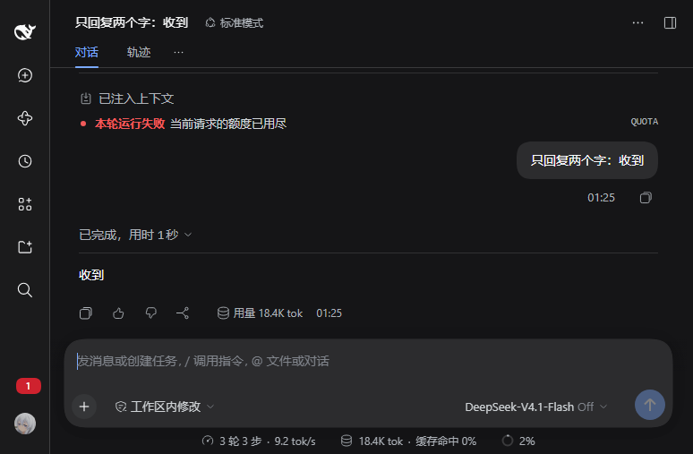
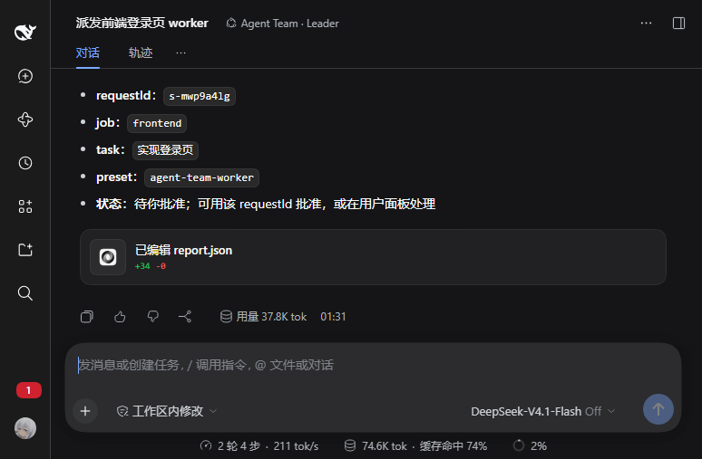
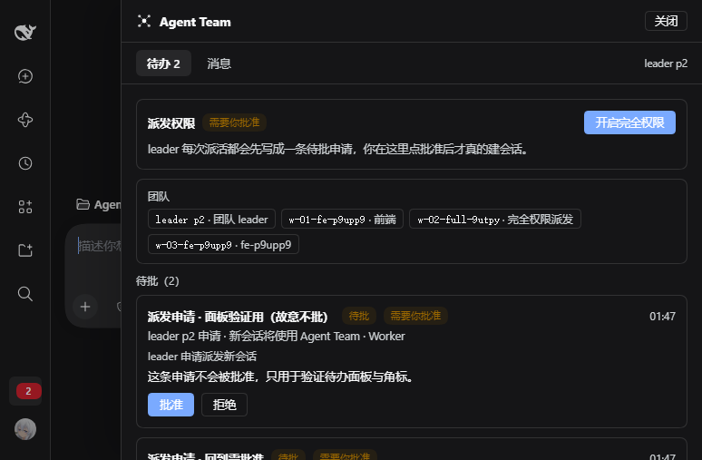
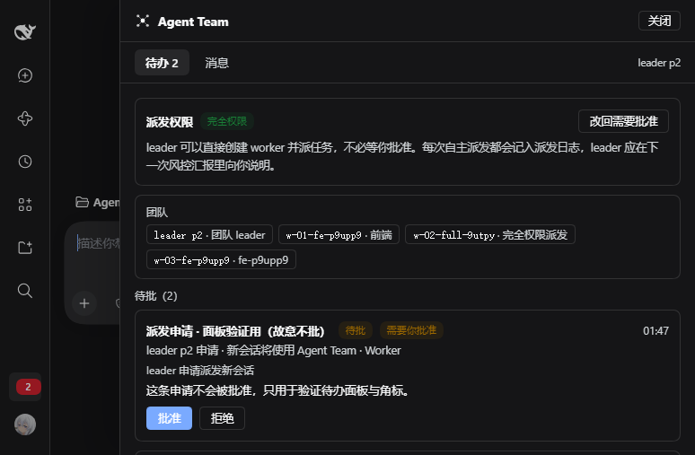
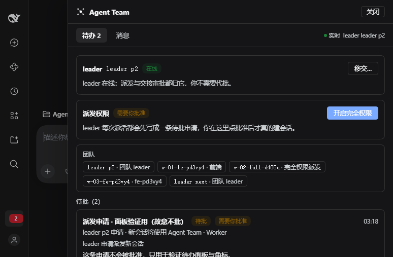
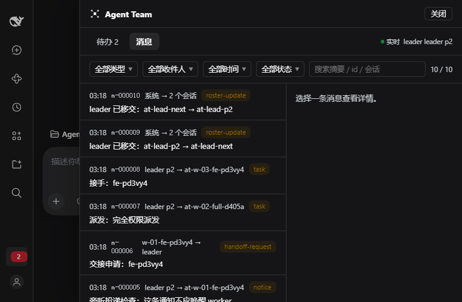

# P2 实测记录：模式隔离

> 结论：**PASS**（15/15）
> 实测时间：2026-11-21 00:44（Asia/Shanghai）
> 宿主：桌面端 DSH `0.2.2-rc.5`（`C:\Software\DSH\resources\app.asar`）
> 证据：`.p2/report.json`（`ok: true`，`errors: []`）
> 隔离环境：独立 profile `p2-test`，**桌面端 profile 未被改动**（见 §1.3）
> 最近一次全量：**124/124 PASS**（2026-11-22 01:08：1.10.0 会话状态能力 + 投递可见性，含 `team_status` 的真机覆盖 §6.28）

---

## 0. 一句话结论

只有 `agent-team` / `agent-team-worker` 两个 preset 的会话能看到团队工具；`standard` 的工具表里**一个都没有**；leader 建出来的 worker 的 preset 确实是 `agent-team-worker`；两个团队会话读写的是 Host 侧**同一份** store。

---

## 1. 环境与做法

### 1.1 为什么不是交接文档里那套源码

交接文档写「本机 DSH：npm 安装 `0.2.0-rc.2`（我核查源码用这个）」。实际运行的是 **`0.2.2-rc.5`**：`app.asar` 里 `dsh/package.json` 的 version 是它，`dsh/desktop-runtime.json` 也一致。两代的 preset/作用域机制不同，所以本次全部按 0.2.2-rc.5 的真实源码核对（用 `scripts/asar-extract.py` 从 asar 抽出来读，副本在 `.diag/dsh-src-022rc5/`，已 gitignore）。

### 1.2 隔离环境怎么搭的

- `p2-test` profile 的 `bundles` 只有 `@deepseek-ai/dsh-base` + `@deepseek-ai/dsh-web-app`（shipped 包，从安装目录解析）。
- 两个自研包用 **junction** 链进 `p2-test/node_modules`：`dsh-agent-team` → `agent-team/`，`dsh-p2-harness` → `spike-p2/`。没有走 pnpm（本机 PATH 上没有 pnpm，桌面 runtime 也没把它放进 PATH）。
- 插件用 **`--patch` 叠加**，不写进任何 profile 的 `bundles`：

```bash
export ELECTRON_RUN_AS_NODE=1
E="<dsh-exe>"
B="<dsh-bin>"
env DSH_P2_AUTORUN=1 "$E" "$B" --profile p2-test \
  --patch "<repo>/agent-team/cordis.patch.yml" \
  --patch "<repo>/spike-p2/cordis.patch.yml" \
  --patch "<repo>/spike-p2/sandbox.patch.yml" \
  --port 0 --no-open
```

**`sandbox.patch.yml` 必须排在最后**（它把 `agent-team-host.workspaceRoot` 改成 `.p2-sandbox`）。少了它，验收会用**桌面端真实团队**的那份 store —— 2026-11-21 就是这么把用户正在用的团队冲掉一次的。

### 1.3 桌面端没有被动过（判据）

```
node scripts/guard-daily-profile.mjs   → exit 0（0 error / 0 warning / 1 info）
desktop bundles → dsh-base, dsh-web-app, dsh-browser-control, dsh-ops, dsh-plugin, dsh-drawai
```

---

## 2. 机制：隔离为什么成立

不是靠 `when` 条件隐藏，也不是靠工具内部检查拒绝：

1. 每个 preset 被 `createScope` 铸成一个**独立作用域**（`dsh-agent-preset-registry/lib/index.js:513`）。
2. 选该 preset 的会话，它的 scope **以 preset scope 为父**（同文件 `:686` `bindScopeParent(key, generation.key)`）。
3. 工具注册表沿 scope 父链继承（`dsh-tools/lib/index.js:477-508` 的 `view(scope)`）。

所以 **preset 插件里 `ctx.tools.register` 的工具，只有该 preset 的会话能继承**；而 Host 插件注册的工具是全局的。这就是为什么本 bundle 的 Host 半边**一个工具都不注册**，只提供状态。

读 preset 的权威 API 也不是 `agent.session.header.agentPreset`（那是初始化时的记录）：0.2.2-rc.5 用投影 —— `ctx.agentPresets.presetForSession(session)`，运行中的 agent 用 `composedPreset(agent.ctx)`。

---

## 3. 判据与结果（15/15）

| # | 判据 | 结果 |
|---|---|---|
| 1 | `standard` 会话看不到本 bundle 的四个工具 | PASS（`ourTeamTools.standard = []`） |
| 2 | `agent-team` 会话拿到 leader 三件套 | PASS（`team_spawn_worker`/`team_post`/`team_roster`） |
| 3 | leader 拿不到 worker 专属的 `team_report` | PASS |
| 4 | `standard` 连查找都查不到（不是"能查到但执行拒绝"） | PASS（`get()` 与 `executable()` 都是 undefined） |
| 5 | ask 档派发只登记申请 | PASS（`status: needs_user_approval`） |
| 6 | ask 档不建会话 | PASS（worker 数不变） |
| 7 | 用户代批后建出的 worker 的 preset 是 `agent-team-worker` | PASS（投影 = `agent-team-worker`） |
| 8 | worker 进了岗位表 | PASS |
| 9 | worker 有 `team_report` | PASS |
| 10 | worker 没有 `team_spawn_worker` | PASS |
| 11 | worker 没有 `team_roster` | PASS |
| 12 | worker 的汇报进了同一个 store，leader 能看到 | PASS（消息 id 对得上） |
| 13 | store 里有派给该 worker 的任务消息 | PASS |
| 14 | 岗位表同时有 leader 与 worker | PASS |
| 15 | 模式选择器数据源里两个模式都在、都没坏 | PASS（`/api/agentPresets/list` 背后的 `agentPresets.list()`） |

模式花名册实测：

```json
[{"id":"standard","order":1},{"id":"ptc","order":2},{"id":"minimal","order":3},{"id":"cordis","order":4},
 {"id":"agent-team","name":"Agent Team · Leader","order":5,"broken":null},
 {"id":"agent-team-worker","name":"Agent Team · Worker（由 leader 自动创建，请勿手选）","order":6,"broken":null}]
```

---

## 4. 附带发现（会影响以后读判据）

1. **官方 Team 工具也在注册表里。** `dsh-base` 已内置 `@deepseek-ai/dsh-agent-team` + `tool-agent-team`：`standard` 会话的 `definitions()` 里能看到 `team_task_create/list/get/update`。它们带 `when` 条件，**步准备时**按 Team 模式筛选（`executable()` 对标准会话返回 `undefined`）。所以「标准模式没有任何团队工具」这条判据必须限定为**本 bundle 的四个工具**，否则会被官方四件套误伤。
2. **`plugin_manager` 在两个 preset 里没有**（`toolDiff.onlyInStandard = ["plugin_manager"]`）。standard 里它是靠 `!!js "!ctx.get('profileContext')"` 条件启用的；preset 作用域里拿不到 `profileContext`，而且让团队会话装插件也不合适。其余工具（含 `office_*`）已对齐。
3. 官方的 `team_task_*` 与我们的 `team_*` 是两套东西：官方是「一个会话里的 subagent 团队」，我们是「平级根会话团队」。互不冲突，名字也不会撞（官方是 `team_task_*`）。

---

## 5. P2 没做的事（边界，别当成已完成）

- **批准 UI**：ask 档的申请目前只能通过 `POST /agent-team/approve {requestId}` 批准（面板属于 P3 前端）。
- **`inject` 投递**：组播一律用 `queue`；设计里「旁听不唤醒」没实现。
- **交接协议**：P1c.2 的交接工具与人类消息守卫还没搬进 preset。
- **正式前端**：侧边栏 + 抽屉未开始。
- 两个 preset 的通用工具清单是从 `standard` **复制**的；DSH 升级时要手工对齐（后续可以做生成脚本）。

---

## 6. 遗留项（2026-11-21 01:20 补测，**32/32 PASS**）

P2 首轮的 `§5` 列了四件没做的事，其中三件本轮做完（正式前端另有记录：[verification-frontend.md](./verification-frontend.md)）。

### 6.1 旁听投递（inject）

**先纠正一条设计假设**：`reusable-solutions.md §3.3` 写的 `{ inject: label }` 投递模式是**官方 prototype** 的写法，**0.2.2-rc.5 没有这个 mode**。这一代的等价机制是 Agent 自己的三个方法（`dsh-agent-loop/lib/index.js:579-587`）：

| 方法 | 语义 |
|---|---|
| `followup` | 下一轮 + **唤醒** |
| `steer` | 下一步 + **唤醒** |
| `inject` | 下一步 + **不唤醒** |

实现：`notice` / `roster-update` 走 `agent.inject()`，`urgent` 走 `steer`，其余走 `queue`。

| 判据 | 结果 | 证据 |
|---|---|---|
| 通知记为 inject 且投递成功 | PASS | `delivery[].mode = "inject"`、`state = "injected"` |
| 不唤醒对端 | PASS | 投递前后 worker 的 `status` 都是 `idle`（先等它空闲再测） |

### 6.2 交接协议搬进 preset

新增两个工具（各自只在自己 preset 的作用域里）：worker 的 `team_handoff_request`、leader 的 `team_handoff_approve`。链路：写自包含交接单 → 上闩 → 给 leader 发申请 → leader 批准 → 建继任会话（同岗位、`agent-team-worker`）→ 更新岗位表 → 投递交接单 → 归档旧会话。

| 判据 | 结果 | 证据 |
|---|---|---|
| 交接单落盘 | PASS | `.team/handoffs/h-*.md` 存在 |
| 申请后上闩 | PASS | `isLatched(worker) = true` |
| 待办面板能看到交接申请 | PASS | `pendingActions()` 含 `type: "handoff"` |
| 批准后建出继任 | PASS | `at-w-02-…`，preset = `agent-team-worker` |
| 旧会话归档、岗位表更新 | PASS | roster 里 `status: "archived"`、`replacedBy` 指向继任 |
| 旧会话解除上闩 | PASS | `isLatched = false` |
| 继任收到任务 | PASS | `kind: "task"`、`summary` 以「接手：」开头 |
| 归档后仍可读 | PASS | `resolveAgent` 不报错 |

### 6.3 人类消息守卫与"只对团队会话生效"

**这一轮踩到一个值得记下来的坑**：我最初用 `sessionController.prompt` 给"已上闩的 worker"发一条消息，期望守卫否决；结果**放行了**。

原因是**判据测错了分支**，不是实现错：`prompt` 造出来的消息 `source.kind` 恒为 `'user'`，而守卫的第一条规则就是「批次里有人类消息就放行」（被 reject 的批次里已 claim 的消息不会入库 —— 拦人类消息就是丢消息）。所以集成测试只能证明"人类消息放行"，证明不了否决分支。这正是交接文档 §5 记的那条未完成项。

处理办法：把决策抽成纯函数 `guardDecision({ latched, messages })`，集成测放行、单测否决。

| 判据 | 结果 | 证据 |
|---|---|---|
| 上闩后人类消息仍放行（集成） | PASS | pre-step 计数 1→2，`rejectCounts` 不变 |
| 上闩 + 非人类消息 → reject（单测） | PASS | `latchedInjected = "reject"`、`latchedEmpty = "reject"` |
| 上闩 + 人类消息 → allow（单测） | PASS | `latchedHuman = "allow"` |
| 未上闩 → allow（单测） | PASS | `unlatchedInjected = "allow"` |
| **守卫只对团队会话生效** | PASS | `preStepCounts` 只含两个 worker 会话；标准会话 `at-std-control` 在 `foreignSessions` 之外一个计数都没有 |

最后一条是本轮最关键的证据：守卫监听器注册在 worker preset 的作用域里，标准会话的一步**根本没进它的视野**（不是"进了但放行"）。这同时验证了 0.2.2-rc.5 的 scope 事件路由对**监听器**也生效，而不只是对工具注册生效。

### 6.4 模型轮次为什么跑不起来（已查清，并更正早先的错误结论）

**早先我写的是「p2-test 没有模型凭据」——这是错的。** 凭据是**全局**的，放在 `~/.dsh/.credentials.yaml`，所有 profile 共用：

- `deepseek-account-platform/default`（账号登录 token，即"账号额度"那条路）
- `refs.DEEPSEEK_API_KEY`（API key，另一条路）

真正的原因是**路由选错了 + 那条路由余额不足**：

| 事实 | 证据 |
|---|---|
| 测试 profile 建出来时没有 `agent-default-model` 配置，落到默认 `deepseek-official` | 探针读到的 `model: { provider: "deepseek-official", model: "deepseek-flash" }` |
| 该路由返回 402 | 事件：`assistant/attempt` 的 `finish.reason.failure = Insufficient Balance (code QUOTA, status 402)` |
| 桌面端用的是 `provider: deepseek-account`（账号额度），所以桌面里一切正常 | `<DSH_HOME>/profiles/desktop/cordis.patch.yml` |
| 显式切到 `deepseek-account` 后**同一个会话立刻成功** | 截图见下，第三轮「已完成 · 收到 · 用量 18.4K tok」 |



同一页里，前两轮红字 `本轮运行失败 · 当前请求的额度已用尽 · QUOTA`，第三轮（用 `selectModel` 切到账号路由后）正常完成。

**对验收的影响**：32 条判据全部不依赖模型输出（计数器 / store / 文件 / 投影），所以结论不变；但"模型真的能干活"这件事在本轮**没有**被验过，直到这张图为止才第一次成功。要长期在测试 profile 里跑真实轮次，需要给它配上 `agent-default-model: { provider: deepseek-account, model: deepseek-flash }`（GUI 打开一次后已自动写进该 profile 的 `cordis.patch.yml`）。

### 6.5 真实一轮：模式被真正使用（2026-11-21 01:31）

在此之前，**没有任何一次真实对话发生在团队模式里**：所有判据都是 harness 直接调 `execute()`（绕过模型），唯一的成功对话是标准模式的「收到」。这一节补上这个缺口。

做法：干净 store 下用 `agent-team` preset 建会话，选 `deepseek-account` 路由，用自然语言让它派活，等模型自己决定调用哪个工具。



实测结果（`.p2/report.live.json`）：

| 项 | 值 |
|---|---|
| 会话 preset | `agent-team`（header 显示 **Agent Team · Leader**） |
| 该会话是不是 leader | 是（store 干净时第一个团队会话） |
| 模型实际调用的工具 | 先 `team_roster{}`，再 `team_spawn_worker{job:"frontend", task:"实现登录页"}` |
| 工具返回 | `{"status":"needs_user_approval","requestId":"s-mwp9a41g","preset":"agent-team-worker"}` |
| 模型行为 | 按指令停止，并把 requestId / 岗位 / 预设 / 待批状态列给用户 |

这就是"模式真的在用"的证据：**隔离 → 工具可见 → 模型自主调用 → ask 档门控生效**，整条链路走通了。

### 6.6 这一轮暴露的真问题：第二个 Leader 会话被拒

第一次跑真实一轮时，store 里已经有 `at-lead-p2` 当 leader（harness 早先建的），新开的 `at-lead-live` 虽然是 `agent-team` 模式，调用 `team_spawn_worker` 却得到：

```
Error: 此会话不是 leader（当前 leader 是 at-lead-p2），leader 工具不能由 worker 调用
```

模型把这个错误如实转述给用户，没有绕路——行为是对的。但**产品层面需要定**：

- 现状符合章程 §3.1「该模式下的第一个会话默认是 leader」——一个团队只有一个 leader；
- 但用户体验是：开了第二个 Leader 模式会话，它什么也做不了，只能让你去第一个会话里干。
- 章程 §3.1 还写了「用户可以直接指定另一个会话为 leader（改 `leader_session`），`leader_assigned_by` 记为 `user`」——这条**没有实现**。

**待决策**：第二个 Leader 会话应该 (a) 明确提示"本队 leader 是 X，要不要接管？"并提供接管工具，(b) 自动接管（generation+1），还是 (c) 一个工作区允许并存多个团队？这是 P3 的第一个设计决策。

> **2026-11-21 用户决定（已实现并验收）**：
> 1. **不接受多个 leader 并存**。要做深靠 worker 底下挂子智能体，不是再开一个 leader 会话。第二个 `agent-team` 会话调 leader 工具直接报错，模型据此告知用户，不自行绕过。
> 2. **审批路径固定**：leader 直接向用户提交"派发"申请；worker 只向 leader 提交"交接"申请；**只有 leader 宕机时，才由用户接管审批**。
>
> 代码里落成三条：`requireLeader` 的报错写明"不允许并存多个 leader"；`pendingActions()` 每条申请带 `awaiting: 'leader' | 'user'`（交接在 leader 不可用时自动转成 `user`）；`approveHandoff(id, 'user')` 在 leader 在线时**直接拒绝**（`leader 在线：交接申请应由 leader 批准，用户只在其不可用时才代批`）。面板对 `awaiting: 'leader'` 的申请只显示"等 leader"，不给批准按钮。
>
> 判据：`singleLeaderEnforced` / `handoffWaitsForLeaderWhenActive` / `userCannotApproveHandoffWhileLeaderActive` 三条通过，总数 35/35。

---


### 6.7 完全权限（2026-11-21 01:48）

用户要求：**允许 leader 跳过用户审批，直接创建 worker 并派发任务**。

实现成一个**用户可随时切换的档位**（不是写死的安装配置），存在 store 里；模型改不了它——只有面板/同源接口能调：

| 档位 | leader 调 `team_spawn_worker` 的结果 |
|---|---|
| `ask`（默认，面板显示「需要你批准」） | 只登记申请，返回 `needs_user_approval` |
| `autonomous`（面板显示「完全权限」） | **直接建会话、直接派活**，返回 `created`，并附一句"已记入派发日志，请在下次风控汇报里说明" |

开了完全权限也不是无痕：每次自主派发都写进 `spawnLog`（会话 / 岗位 / 谁申请 / 权限档 / 时间），`activity()` 给出 `fullAuthoritySpawns` 计数，档位切换本身写进 `authorityLog`。

| 判据 | 结果 | 证据 |
|---|---|---|
| 完全权限下直接建 worker、不产生待批申请 | PASS | `status: "created"`、`sessionId: at-w-02-full-9utpy`、待批数不变 |
| 每次自主派发留痕 | PASS | `spawnLog` 有该会话、`authority: "autonomous"` |
| 切回 `ask` 立刻恢复门控 | PASS | 同样的调用返回 `needs_user_approval` |
| 档位切换本身有记录 | PASS | `authorityLog` 两条 |

**「需要你批准」时的面板：**



**开启「完全权限」之后：**



面板上的开关是给**用户**用的；开启要点一次「确认开启」，改回是单击。模型没有工具能改它。

---

### 6.8 会话命名 + 清场安全阀（2026-11-21 02:36）

**现象**：worker 会话在侧边栏显示成 `[Agent Team m-000001] fro…`，人认不出是哪个岗位。

**原因**：DSH 的 `session-title-first-prompt-llm` 用会话收到的**第一条 human 消息**生成标题；我们投递给 worker 的第一条是内部信封：

```
[Agent Team m-000001] from=at-lead-second kind=task priority=normal
summary: 派发：前端
body: …/bodies/m-000001.md
```

于是标题被信封定死。这也解释了"新会话看不见"的错觉——它一直在，只是埋在列表第 47 位、标题还认不出来。

**修法**：建完会话**先 `rename` 再投递**。`dsh-session-title` 的 `rename` 写入 `source.kind: "user"`，会**钉住**标题并取消在途的自动生成（`dsh-session-title/lib/index.js:292-311`）。顺序反了就白做：标题会先被第一条消息定死。

标题格式：`<岗位> · <任务前 24 字>`，例如 `frontend · 实现登录页`。

**清场安全阀**：批量归档用 `archiveSession(id, { stopActivity: true })`，会**打断正在运行的会话**。2026-11-21 就因为没有这道判断，一次 `prefix: "at-"` 的批处理把调用方自己（会话 id 也以 `at-` 开头）归档并掐断。现在 `setArchived` 会跳过**正在跑**的会话，并在返回值里列出 `skippedLive`。
（1.7.1 修正：以前只要 agent 被实例化过就跳过，导致"刚跑过、现在空闲"的会话永远归档不掉——
2026-11-21 清场时 3 个空闲会话全被跳过，最后由用户**在界面手动归档**；现在判据是 `agent.status === 'running'`。）

---

### 6.9 真实创建流程：申请 → 审批 → 建会话 → 派活（2026-11-21 02:50，桌面端实测）

前面 §6.5 验的是"模式能跑、模型会调工具"，§6.2 的交接/建会话是 harness 直接调 `execute()`。这一节是**在用户的桌面端、用真实模型、走完整条链路**的实测。

**触发方式**：用户对 `Agent Team · Leader` 会话说「再派一个 backend worker，任务：写一份接口约定草稿。先看岗位表。」，在抽屉里点了「批准」。

**结果（团队 store 原始记录）**：

| 环节 | 证据 |
|---|---|
| leader 申请 | `spawnRequests` 新增一条（`s-…`），用户批准后 `status: approved` |
| 自动建会话 | 岗位表多出 `at-w-02-backend`；`spawnLog` 1→2 条；`nextWorkerSeq` 2→3 |
| 自动派活 | worker 收到 `task`（`delivery: delivered`）并开始执行，产出 `docs/api-contract.draft.md` |
| **通知 leader** | `m-000011 at-system → at-lead-second | roster-update | queue | delivered`，摘要「已批准派发：backend → at-w-02-backend」 |
| 双向通信 | 之后 leader↔worker 往返 8 条（`report` / `answer` 交替），全部 `delivered` |
| 旁听 | 收工那两条走 `notice` → `inject`，状态 `injected`（不唤醒） |

**同时验证的两条修复**：

- 「批准后通知 leader」生效（§6.8 的 A 项之前是缺失的）；
- worker 会话标题由 `nameSession` 钉住，不再被 `[Agent Team m-…]` 信封污染。

**行为观察**：leader 没有为同一岗位重复建会话——它先看岗位表，已有 `frontend` 就直接复用，只有新岗位 `backend` 才申请新建。这符合"一个团队一个 leader、岗位靠派发"的设计。

**产物边界**：worker 写出的 `README.outline.md` 与 `docs/api-contract.draft.md` 按用户决定**不入库**（已加入 `.gitignore` 的 `*.draft.md` / `README.outline.md`）。

---

### 6.10 leader 移交：宕机后的人工接管（2026-11-21 03:17）

**缺口**：leader 会话被归档（宕机、误删、用户自己关掉）之后，`state.leader` 仍然指着它：
`claimLeader` 不肯再认第二个 leader，于是**派发没人批、worker 的交接申请发给一个死会话**，团队一直挂着。交接审批倒是会自动落到用户身上（`pendingActions()` 里 `awaiting: 'user'`），但用户没有任何办法把团队救回来。

**修法（守住用户 2026-11-21 的两条决定）**：

| 决定 | 在这里怎么守 |
|---|---|
| 不接受多个 leader 并存 | 移交是**一次写盘里先卸任再任命**：旧 leader 标 `status: 'replaced'` + `replacedBy`（留档不删），`state.leader` 同时换人 —— 没有两个 leader 并存的中间态 |
| 宕机后由**人工**接管 | 这条路径只开给面板/HTTP（`POST /agent-team/admin/promote-leader`，必须带 `confirm: "PROMOTE"`），**没有任何工具转发给它**，模型调不到。`claimLeader` 依旧拒绝自动接手 |

拒绝的两种情况（判据是错误信息）：目标已归档 → `目标会话已归档：…`；会话根本不存在 → `会话不存在：…`。
「存在」查三处：岗位表、工作区 `sessionIds` 索引、`sessionController.resolveAgent()` —— 只看 `sessionIds` 会误判（会话 header 落盘前它不在索引里，`dsh-workspace:102`）。

**生效面**：

- 换人后向**还活着**的成员发 `roster-update`（走 `inject`，不唤醒算力）："leader 已移交：A → B"；
- 用户代批交接单时，「接手」任务改由 `at-system` 署名（`leaderState().available === false`），不再冒充已归档的 leader；
- 每次移交写进 `store.leaderHistory`（`{at, by, from, to, reason}`，留最近 50 条），面板 `/state` 能看到最近 5 条；
- 换错预设会给警告：目标是普通会话时只有审批权、没有派发工具（那些工具只装配在 `agent-team` 作用域里）。

**验收（52/52 PASS，沙箱 profile `p2-test`）**：

```bash
rm -rf .p2-sandbox/.team .p2/report.json
timeout -s KILL 150 env DSH_P2_AUTORUN=1 "$E" "$B" --profile p2-test \
  --patch "<repo>/agent-team/cordis.patch.yml" \
  --patch "<repo>/spike-p2/cordis.patch.yml" \
  --patch "<repo>/spike-p2/sandbox.patch.yml" --port 0 --no-open
# → .p2/report.json: ok: true, 52 checks, errors: []
```

8 条新断言（`report.checks`）：

| 断言 | 判据 |
|---|---|
| `promoteLeaderSettlesOnLeaderPresetSession` | 归位后 `leaderState().id === at-lead-p2` |
| `promoteLeaderIdempotent` | 目标是现任 leader → `changed:false, reason:'already-leader'`，不写盘 |
| `promoteLeaderRefusesArchived` | 已归档的 worker → 报错含「已归档」 |
| `promoteLeaderRefusesUnknownSession` | `at-nobody-harness` → 报错含「不存在」 |
| `stateRouteExposesLeaderStatus` | `GET /agent-team/state` 带 `leaderStatus.{id,available}` 与 `leaderHistory[]` |
| `promoteRouteRequiresConfirm` | 不带 `confirm` 的 POST → **400**（面板误点不会静默换人） |
| `promoteLeaderDemotesPrevious` | 旧 leader 变 `replaced` 且 `replacedBy` 指向新 leader；`isLeader` 一真一假 |
| `promoteRouteTransfersLeader` | 面板那条路由真把 leader 换回来（200 + `changed:true`） |

`report.evidence.leaderTransfer` 里能直接看到 `moved.notified`（收到通知的活会话）、两次移交的 `leaderHistory`、以及两种拒绝的原文。

**前端实测（p2-test 的 web UI，真浏览器）**：



标题栏右侧的绿点 `实时` 是 SSE 连着（不是轮询）；`leader leader p2 · 在线` 来自 `leaderStatus`；卡片里的「移交…」展开就是输入框 + 候选按钮 + 原因。

**顺带修掉的 harness 假通过**：`check()` 原来写 `Boolean(fn())`，异步断言返回的 Promise 恒为真 → 静默通过。现在 `check()` 见到 Promise 直接判失败，异步断言走 `await checkAsync()`。

---

### 6.11 面板筛选与 SSE 实时刷新（2026-11-21 03:21）

**为什么动它**：面板原来每 3 秒整份 `/state` 轮询；消息页只有一个"类型"下拉和一个搜索框。`panels.md` 里要求的收件人 / 时间 / 状态筛选和事件流都还欠着。

**筛选（纯前端，`client.js`）**：

| 筛选 | 取值 | 判据 |
|---|---|---|
| 收件人 | 由已加载的 `to[]` 汇总出的会话列表 | `row.to.includes(id)`（逐收件人，不是 `toExpr` 字符串） |
| 时间 | 最近 1 小时 / 最近 24 小时 / 今天 | `new Date(row.ts).getTime() >= floor`，不看已读 |
| 状态 | 有投递失败 / 未投递 / 已投递 / 已旁听 | 逐收件人 `delivery[].state`，任一命中即命中 |
| 类型 | 已有 | `row.kind` |

四个下拉 + 搜索可叠加；任一生效时出现「清空」，右上角始终是 `命中 / 总数`。

**SSE（`index.js` 的 `streamEvents` + `client.js` 的 `useTeam`）**：

- 路由：`GET /agent-team/events`，`text/event-stream`；连接先发 `event: ready`，之后每次 `save()` 发 `event: team`（只带递增 `seq` 与时间，不带内容）。
- 合并：`save()` 可能连着触发（派发一次会写好几回），`scheduleNotify()` 按 **120ms** 合并。
- 心跳：25 秒一次注释帧 `: ping`（不算事件），断连时 `req/res` 的 `close` 事件把订阅和定时器都清掉。
- 前端：`EventSource('/agent-team/events')` 连上 → **停轮询**；`onerror` → 恢复 3 秒轮询，浏览器按 `retry: 3000` 自己重连。抽屉标题栏的小圆点显示**实时**（绿）还是**轮询**（黄）——降级看得见。
- 为什么只推"变了"而不推内容：面板重拉 `/state` 拿的是和审计同一份投影，不会出现"推送里的计数和列表对不上"。

**验收（54/54 PASS）**：

```
.p2/report.json → ok: true, 54 checks, errors: []
evidence.sse = { sawReady: true, sawTeam: true, bytes: 104 }
```

| 断言 | 判据 |
|---|---|
| `eventsRouteOpensSseStream` | 连上 3 秒内收到 `event: ready` 与 `retry:` |
| `eventsPushesOnStoreChange` | 连接期间真改一次 store（`setAuthority` 同值重写），4 秒内收到 `event: team` |

`eventsPushesOnStoreChange` 是**真推**，不是拿单测替身：它在验收宿主里开一条真 HTTP 流，再触发一次真写盘。

**前端实测（p2-test 的 web UI，真浏览器）**：



四个下拉 + 搜索 + `10 / 10` 计数都渲染出来了；标题栏的绿点 `实时` 说明这条流是真的握着（服务端 `event: ready` 之后前端才把轮询停掉）。

**没有验证到的**：下拉和搜索的**交互**没法在没有真实指针事件的环境里驱动（React 受控组件对 `dispatchEvent` 不买账，试过原生 setter + `input`/`change` 都不生效）。所以"筛了确实少"这一条属于**渲染与代码评审已验证、交互待肉眼确认**——在桌面端复核后补记在这里。

---

### 6.12 深色主题：原生下拉换成自绘控件（2026-11-21 03:32）

**现象**：用户报"下拉框还是原始白底，统一成 DSH 的深色模式"。

**先量再改**（在真浏览器里读计算样式，不猜）：

| 量什么 | 结果 |
|---|---|
| `getComputedStyle(document.documentElement).colorScheme` | `dark`（DSH 自己在 `html` 上设了） |
| `--dsw-alias-bg-base` | `rgb(21, 21, 23)` |
| `label-secondary` / `label-tertiary` | `rgb(207,211,214)` / `rgb(173,178,184)` |
| `border-l1/l2/l3/l4` | 白 6% / 12% / 16% / 20% |
| `interactive-bg-hover` / `-active` | 白 8% / 14% |
| `state-business-primary` | `rgb(122,170,255)` |
| `bg-elevated` / `bg-popover` / `fill-*` | **不存在**（`var()` 无效 → 回落到继承色） |

结论：主题本身是深色，**问题不在 token**，而在原生 `<select>`：它的**弹出列表由系统绘制**，不吃页面的 `background`/`color`（`color-scheme` 也管不牢）。所以换成自绘控件（按钮 + 绝对定位列表），颜色全走上面这些真实存在的 token。

**实现要点**（`client.js` 的 `Select`）：

- 列表底：`color-mix(in srgb, var(--dsw-alias-bg-base) 92%, var(--dsw-alias-label-primary) 8%)` —— 深色主题变亮、浅色主题变暗，抬高感在两种主题下都成立（不用 `bg-elevated`，它不存在）；
- 选中项 `interactive-bg-active`、悬停 `interactive-bg-hover`、边框 `border-l2`、阴影 `0 10px 28px rgba(0,0,0,.32)`；
- 点外部 `mousedown` 关闭、`Esc` 关闭（监听在 `document`，卸载时清掉）；
- 筛选栏加 `position: relative; z-index: 5`，列表 `z-index: 30`，避免被下方消息列表盖住。

**验证到什么程度**：

- 自绘控件在 p2-test 的 web UI 里**真渲染出来了**（`docs/assets/agent-team-filters.png`：四个带 ▼ 的按钮，深色底、浅色字）；
- **没能自动验"点开后的列表"**：截图时机比 `setTimeout/setInterval` 的第一次 tick 还早（试过 100/120/150/1500ms 与 rAF 组合），而同步 `click()` 时抽屉还没挂载（React 不在事件派发内同步提交），所以自动化点不开它。
- **用户 2026-11-21 在桌面端手动验证通过**（颜色/边框/遮挡都正常）；按用户要求不截图留证。

---

### 6.13 preset 工具清单改为从 `standard` 生成（2026-11-21 03:40）

**病根**：preset 的 `config.plugins` 是**完整清单**（没有"继承 standard"这种写法），所以两个团队 preset 只能把 shipped `standard` 的 20 多个插件逐字抄一份。DSH 升级时 standard 会动，抄本不会跟着动 —— 那是**静默漂移**：会话看着正常，实际少了工具。

**这次就抓到一个**：`preset-agent-team-worker` 的抄本**整个缺了 `delegation` 组**（`tool-subagent` / `tool-subagent_fork` / `tool-workflow`）—— 也就是说 worker 会话之前根本挂不了子智能体，而"团队做深靠 worker 挂子智能体"正是用户 2026-11-21 定的路线。leader 那份是有的，所以这个洞一直没被注意到。

**做法**（`scripts/gen-preset-tools.mjs`）：

- 唯一事实源 = 安装目录 `app.asar` 里的 `dsh-web-app/presets/standard.patch.yml`（不是仓库里的抄本，所以升级后读到的就是新版）；
- 团队 preset 只声明**差异**：`override`（`persona` 用自己的系统提示）、`append`（`tool-agent-team-leader` / `-worker`）、`remove`（`tool-plugin-manager` / `tool-plugin-market`：团队会话不该自己装卸插件）；
- 生成时按 standard 的顺序重写整份清单，**未声明的条目一律不允许留在文件里**（既不在 standard、又没写进 append/override 就报错退出 2）；
- `--check`（pre-commit 调用）/ `--write` / `--diff`。

**两个坑，都踩过**：

1. **CRLF**：仓库里的 YAML 是 CRLF、asar 里是 LF，不归一化的话 diff 全是"看起来一样却不等"的假差异（`- x` / `+ x` 成对出现）。
2. **Python stdout 编码**：`asar-extract.py cat` 走 stdout，Windows 控制台代码页（cp936）会把 plan-mode 那段里的长破折号 `—` 变成 `U+FFFD` 写回 YAML —— 内容被弄坏，但 diff 只显示成一行差异。现在改用 `x` 子命令**落地成临时文件**再按 utf8 读。

**判据**：

```bash
node scripts/gen-preset-tools.mjs --check   # exit 0，输出 "standard 23 项，2 个 slot"
sh .githooks/pre-commit                     # exit 0（已把 --check 接进 pre-commit）
```

两个 preset 现在各 22 项，除了团队工具那一项之外**逐条相同**（`standard 23 − remove 2 + append 1`）。harness 54/54 不变：`evidence.toolCounts = {standard:40, leader:43, worker:42}`（工具**定义**数，不是插件数）。

---

### 6.14 交接「要求补充」路径（2026-11-21 03:47）

`panels.md` 的待办面板一直写着三条路径（批准 / 拒绝 / 要求补充），实现里只有前两条：交接单不合格时，leader 只有"照批"或"整张拒掉"两个选择，**没有"先回去补"**。

**语义（这次定的）**：

| 项 | 决定 | 理由 |
|---|---|---|
| 申请状态 | **保持 `pending`**，只记 `infoRequested {at, by, note}` | "要求补充"不是终局，列表里还得看得见 |
| 申请方上闩 | **解除** | 上闩守卫会否决 worker 的下一步，不解闩它没法补单子 |
| 通知 | `question`（走 `queue`，唤醒它） | 这是要对方行动的消息，不能只旁听 |
| 补齐后 | 重新调 `team_handoff_request` → **更新同一张单子**（同 id、`revisions+1`、清掉 `infoRequested`、重新上闩） | 否则会变成两张单子，leader 还得猜哪张是新的 |
| 谁能要求 | leader（`team_handoff_more_info`）与用户（面板按钮 → `POST /agent-team/more-info`） | 与批准/拒绝的权限一致 |
| 必填 | `note` 必填（空/空白字符一律拒） | 不写"缺什么"的回执等于没说 |

**验收（63/63 PASS）**：9 条新断言

| 断言 | 判据 |
|---|---|
| `moreInfoKeepsPending` | `status` 仍是 `pending`，`pendingHandoffs()` 里还有它 |
| `moreInfoRecordsRequest` | `infoRequested.note/by` 与传入一致 |
| `moreInfoUnlatchesApplicant` | `isLatched(worker)` 变 false |
| `moreInfoNotifiesApplicant` | 有一条 `question` 发到 worker，摘要以「交接单要补充」开头 |
| `moreInfoRequiresNote` | 空白 note → 报错含「note 必填」 |
| `moreInfoRouteExists` | `POST /agent-team/more-info` 命中路由（未知 id 走 500 + 「未知交接申请」，而不是 404） |
| `handoffReRequestUpdatesInPlace` | 重新提交后 id 不变、同一会话只有 1 张挂起单、`artifacts` 已更新、`infoRequested` 已清 |
| `handoffReRequestRelatches` | 重新上闩，`revisions ≥ 1` |
| `handoffReRequestNotifiesLeader` | leader 收到摘要以「交接单已补充」开头的 `handoff-request` |

`evidence.handoffInfo` 里能直接看到 `asked.infoRequested`、`reRequest.sameId`、`reRequest.revisions`。

---

### 6.15 消息列表分页（2026-11-21 03:50）

`/state` 一直只回最新 100 条，更早的消息在面板上**根本看不见**（不是折叠，是没取）。现在补上：

| 侧 | 改动 |
|---|---|
| 服务端 | `messages({limit, since, before})` 支持 **id 游标**：`since` = 比它新（增量刷新）、`before` = 比它旧（往前翻页）；两种都返回时间正序的尾部 `limit` 条 |
| `/state` | 多带 `totalMessages`（含没被 `rows` 带出来的），面板据此才知道还有没有更早的 |
| `/messages` | 路由转发 `before`（原来只认 `limit` / `since`） |
| 面板 | 列表底部「加载更早（还有 N 条）」；按 id 游标往前翻、按 id 去重，页与页不重叠；计数从 `命中 / 已加载` 变成 `命中 / 已加载（共 N）` |

**为什么用 id 游标而不是 offset**：消息只会追加，不会插到中间；offset 分页在"翻页期间来了新消息"时会漏条/重条。id 是单调递增的（`m-000001`…），比较大小就够了。

**验收（67/67 PASS）**：

| 断言 | 判据 |
|---|---|
| `messagesBeforeCursorPages` | 以最新 3 条里最旧的那条为游标，往前取到的一页**全部**严格更旧且非空 |
| `messagesBeforeCursorNoOverlap` | 这一页与最新 3 条没有交集 |
| `stateExposesTotalMessages` | `/state` 带整数 `totalMessages ≥ rows.length` |
| `messagesRouteAcceptsBefore` | `/messages?limit=2&before=…` 命中路由、条数 ≤ 2、id 全部更旧 |

`evidence.pagination = {cursor: "m-000011", newestIds: [...], pageIds: ["m-000001"…"m-000010"], pageCount: 10}` —— 10 条页、零重叠。

---

### 6.16 store 保留策略：超上限**归档**，不删（2026-11-21 04:00）

`.team/store.json` 与 `.team/bodies/` 之前没有上限：消息一条条累加，正文一条一个 md，跑久了只会涨。

**策略**（`agent-team/index.js`）：

| 项 | 值 | 说明 |
|---|---|---|
| `maxMessages`（ceiling） | 5000 | 活跃 store 超过它就动手（`post()` 尾部调用） |
| `retainMessages`（keep） | 2000 | 动手时把活跃量降回这个数 |
| 归档位置 | `.team/archive/messages/<首id>..<末id>.json` | 整条消息（含 `bodyPath`）原样搬走 |
| 正文 | **不删** | `bodies/*.md` 留在原地，归档里记的是路径 |
| 顺序 | 写归档 → **回读校验** → 才从 store 摘除 | 校验不一致就抛错、store 原封不动（宁可涨，不丢） |
| 未投递成功的 | 不归档 | `delivery` 里还有 `pending` 的消息要重投，不能挪 |
| 判据 | 纯函数 `pruneDecision({count, keep, ceiling})` | 返回 `null`（不动）或 `{drop, keep}`，单测覆盖 |
| 手动 | `POST /agent-team/admin/prune` | **默认干跑**（只回计划）；真跑要 `confirm: "PRUNE"` |
| 留痕 | `state.pruneLog`（最多 50 条）+ `activity().archivedMessages` | 归档也留记录 |

**验收（75/75 PASS）**：8 条新断言

| 断言 | 判据 |
|---|---|
| `pruneDecisionBelowCeiling` | 未超上限 → `null` |
| `pruneDecisionAboveCeiling` | count 10 / ceiling 8 / keep 5 → `{drop:5, keep:5}` |
| `pruneDryRunTouchesNothing` | 干跑给出计划，但消息数不变、归档文件不存在 |
| `pruneArchivesAndKeepsNewest` | 真跑后活跃只剩 keep 条，最新那条还在 |
| `pruneArchiveIsVerifiedCopy` | 归档 `count`/条数/首尾 id 与 `range` 完全一致 |
| `pruneKeepsBodiesOnDisk` | 归档里每条消息的 `bodyPath` 都还在盘上 |
| `pruneLogRecorded` | `retention.history` 有这条、`archivedMessages` 累加、`size` 与活跃数一致 |
| `pruneRouteDefaultsToDryRun` | 不带 `confirm` 的 POST 只返回计划（`archived:false`） |

`evidence.retention = {dryRun:{drop:9,range:"m-000001..m-000009"}, real:{...}, archiveSample:[...]}`。

**已知取舍**：归档里的消息面板看不到（`/body` 只查活跃 store）—— 要看历史得直接读归档 json。这是"活跃 store 有界"的代价，写在这里避免下一个人以为是 bug。

---

### 6.17 多个 worker 同时汇报会怎样：**逐条排队，一条一轮**（2026-11-21 04:00，源码核对）

这是用户的问题，答案分两段：我们这一侧怎么发，DSH 那一侧怎么收。

**我们这一侧**（`agent-team/index.js`）：

- `post()` 先入库（`state.messages.push`），再 `await deliver()`；`deliver()` 是**单写者循环**，按消息 id 顺序逐条投递，**投完一条才投下一条**。所以同一个 Host 里，投递顺序 = `post()` 的调用顺序。
- 投递方式由 `deliveryModeOf({kind, priority})` 决定：`urgent` → `steer`；`notice` / `roster-update` → `inject`（**不唤醒**）；其余（`task`/`question`/`answer`/`report`/`handoff-*`）→ `queue`。

**DSH 这一侧**（`0.2.2-rc.5` 源码）：

1. `prompt({mode:'queue'})` → `agent.followup(message)`；`steer` → `agent.steer(message)`（`dsh-api-session-controller/lib/index.js:932`）。
2. `followup` 就是 `send(message, 'next-turn', wakeup=true)`：**追加**到该会话的 `next-turn` 队列尾部并唤醒 driver（`dsh-agent-loop/lib/index.js:573-580`）。
3. 每一步的 `inbox.claim(target)` 取 `next-turn` 时用的是 `mutate('next-turn', 0, 1)` —— **一次只取 1 条**（`dsh-agent-loop/lib/index.js:103-105`）；`next-step`（steer / inject）则整批跟着这一轮一起被取走。
4. 幂等：`prompt` 受理前查 `hasPromptRequest(session, requestId)`，我们的 `requestId` 是 `<消息id>-<会话>`，所以重投不会重复（`dsh-api-session-controller/lib/index.js:920`）。

**所以结论**：

- **会排队**，而且是**一条消息一轮**、按到达顺序 FIFO —— 3 个 worker 同时汇报，leader 要跑 **3 轮**，不是把 3 条并进一轮。
- 也不会"互相覆盖"或"只看到最后一条"：每条都是独立的 `next-turn` 项，durable 存在会话日志里（崩了重启还在）。
- `inject`（旁听/状态）**不排队**，它躺在 `next-step`，等 leader 下一次真的开跑时搭车进来，不额外唤醒。

**要知道的四个边界**：

1. **没有优先级、没有合并**：全是 FIFO。想要"先看汇总"就得靠协议（让 worker 发 `notice` 汇总，或让 leader 群发 `role:` 要求一句话汇报），队列本身不做。
2. **`urgent` 不是"插队"**：它走 `steer`，只在 leader **正在跑**时打进当前这一步；leader 空闲时它同样等下一轮，和排队没区别。
3. **队列没有上限**：leader 被卡住时 `next-turn` 会一直堆（durable）。但 leader **归档**后不是堆积而是**投递失败**——`prompt` 报错，消息 `delivery` 记 `failed`，不静默丢。
4. **我们这边是串行投递**：`deliver()` 逐条 `await`，某条投递卡住会拖住后面的（单写者设计，换来"顺序可解释"）。

---

### 6.18 worker ↔ worker 互通：协议层早验过，P2 工具层这次补上（2026-11-21 11:32）

**用户提出**：「我记忆里 worker 之间的互相通信没测过」。查过之后结论是**一半对**：

| 层 | 测过吗 | 证据 |
|---|---|---|
| **协议 / 服务层**：worker 按会话 id 发给同行、只有收件人看到、投递状态 | ✅ 2026-11-20 **P1b 测过** | [`verification-p1b.md`](./verification-p1b.md) 的 4/4 矩阵；`.p1b/report.json` 里 `at-w-02` 期望 `PEER-CALL` 且命中、`at-w-01`/`at-w-03` 各收到、`at-w-01` **没有** SUBSET-CALL；验证方式读 **durable session logs** 比对 marker（`scripts/verify-p1b.mjs`） |
| **P2 实现（preset 作用域 + 真实 `team_post` 工具）** | ❌ **之前没测** | 原 75 项里一条 peer 都没有 |

**为什么 P1b 不算数**：那一版是预览实现（`plugin/index.js`），**不注册任何工具**；`PEER-CALL` 是演示流程直接调服务
（`plugin/index.js:214` 的 `post({from:'at-w-02', toExpr:[...]})`）。`verification-p1b.md` 自己也把
「与真实 leader/worker 工具（而不是演示脚本）的接线」列在未做项里。所以 peer 分支在 P2 是**新写的代码**，没有回归测试。

**这次补的 8 条断言（83/83 PASS）**：

| 断言 | 判据 |
|---|---|
| `workerCanMessagePeerById` | worker `team_post` 发给同行的会话 id → `to = [对方]`，`to.length === 1` |
| `workerPeerMessageDelivered` | 该消息的 `delivery` 全部 `delivered` |
| `workerPeerMessageReachesPeerInbox` | **不只查 store**：读对方会话的事件，里面真的出现这条的 marker（照 P1b 那个更硬的判据写） |
| `workerCannotBroadcastAll` | `to: 'all'` → `只有 leader 可以发给全体` |
| `workerCannotGroupByRole` | `to: 'role:<岗位>'` → `只有 leader 可以按岗位群发` |
| `workerCannotMessageOutsider` | 团队外的 id → `收件人不是团队成员` |
| `workerCannotMessageSelf` | 发给自己 → `收件人只有发送者自己` |
| `workerHasNoDiscoveryTool` | worker 的工具表里既没有 `team_roster` 也没有 `team_directory` |

`evidence.workerPeer = {from:"at-w-03-…", to:"at-w-02-full-…", messageId:"m-000011", delivery:[{state:"delivered", mode:"queue"}], markerInInbox:true, refused:{broadcast,byRole,outsider,self}}`。

**顺带记下两条现状（都是"能用但不理想"，这次没改）**：

1. **发现机制缺口**：worker 没有 `team_roster`，所以它**没法主动问"团队里还有谁"**——只能从收到的消息信封
   `from=<会话 id>` 里学到同事的 id。协议允许互通，但"怎么知道找谁"没给 worker 答案。
   要补就是加一个 worker 作用域的只读 `team_directory`（只回 `{session, job}`，不含活动指标与待批申请）。
2. **上闩挡不住外来消息**：`deliver()` 走 `sessionController.prompt(...)`，而 prompt 造出来的消息 `source.kind` 恒为
   `'user'`——正是上闩守卫的"人类消息放行"分支。所以一个已上闩的 worker，收到**任何** prompt 投递的消息（同行的、
   leader 的）都会真的跑一轮；上闩实际只阻断**同一轮内的自动续跑**。想让上闩变成"隔离"，得把 `queue`/`steer` 也改成
   直接 `agent.followup/steer` 并带上我们自己的 `source.kind`（`inject` 已经这么做，所以它才拦得住）。

---

### 6.19 worker 通讯录 + 上闩真隔离（2026-11-21 11:54）

用户在看完 §6.18 后要求两件事，都做了。

#### (1) worker 也需要知道同事是谁 → `team_directory`

原来 worker 只能从收到的信封 `from=<会话 id>` 里学到同事——协议允许互通，但没有发现机制。

新工具（**worker 作用域**，只读）：`team_directory({role?})` → `{leader, total, members:[{session, job, role, title, isLeader, self}]}`。
**只给"谁是谁"**，不含活动指标、不含待批申请（那些仍然是 leader 的 `team_roster`）。已归档/被替换的会话不列。

#### (2) 上闩必须真隔离 → 两层

问题有两面：

1. **上闩中仍会被投递**：`deliver()` 不看闩，消息照样进对方 inbox（对方跑一轮）。
2. **消息冒充人类**：投递走 `sessionController.prompt(...)`，它造出来的消息 `source.kind` 恒为 `'user'`
   —— 正好命中上闩守卫的"人类消息放行"分支。所以守卫那一层从来没真正拦过团队消息（只能单测）。

改法：

| 层 | 改动 |
|---|---|
| 投递 | `queue`/`steer` 不再走 `prompt`，改成自己造消息后直接 `agent.followup()` / `agent.steer()`，消息带 `source: { kind: 'agent-team', messageId, mode }`（`inject` 一直这么做） |
| 暂扣 | `deliver()` 发现目标**已上闩** → 不投递，slot 标 `held`（面板显示"上闩暂扣"） |
| 补投 | `unlatch()` 之后把该会话所有 `held` slot 改回 `pending` 并重跑 `deliver()` |
| 守卫 | 不变（它本来就拦非人类来源），但因为消息现在带 `agent-team` 来源，**否决分支第一次变成可集成验证的** |

**代价（如实记）**：绕开 `prompt` 就失去了它的 `requestId` 幂等，改用我们自己 slot 状态机做去重（每个 slot 标 `delivered` 后 `save()`，窗口极小）；
另有一个残余窗口：已被 inbox 取走、但随后被守卫否决的消息**不会回到队列**（`kind:'reject'` 让这一轮以 `blocked` 结束，`dsh-agent-loop:759-761`）——即"投出去之后才上闩"的极窄窗口里可能丢一条。上闩期间是**暂扣**，不是丢。

#### 验收（89/89 PASS，6 条新断言）

| 断言 | 判据 |
|---|---|
| `workerDirectoryListsPeers` | 通讯录里有同行的会话 id 与岗位、有 leader 且 `isLeader:true`、**没有** `activity`/`pending` 字段 |
| `workerDirectoryMarksSelf` | 调用者自己那条 `self:true` |
| `workerDirectoryExcludesArchived` | 已归档的旧 worker 不在列表里 |
| `latchedDeliveryIsHeld` | 对已上闩会话 `post` → 该 slot 状态是 `held`（不投递） |
| `unlatchRedeliversHeld` | `unlatch` 后 5 秒内同一 slot 变 `delivered` |
| `guardRejectsTeamMessageWhileLatched` | 上闩中直投一条 `source.kind:'agent-team'` 的消息 → `rejectCounts` 0→1（**守卫的分支第一次被集成验证**） |
| `workerHasDirectoryButNoRoster` | worker 有 `team_directory`、仍然没有 `team_roster` |

`evidence.latchIsolation = {heldAtLatch:"held", afterUnlatch:"delivered", released:true, rejects:{before:0, after:1}, directory:{total:3, members:["at-lead-p2:leader/leader", …]}}`。

由此，§6.18 里记的两条"现状"（没有发现机制、上闩挡不住外来消息）**已经解决**，那两条描述不再适用。

---

### 6.20 上下文裁剪 + 广播排除归档（2026-11-21 12:30）

用户批准了上一轮建议里的 **1（裁剪上下文）** 与 **3（广播排除归档会话）**。

#### 先量再改：一次团队会话的请求里到底装了什么

拿真实桌面端的 worker 会话（`at-w-03-qa`，126k 上下文的请求）逐块量：

| 组成 | 尺寸 | 占比 | 我们能不能动 |
|---|---|---|---|
| 工具 schema（61 个） | 65,649 字符 ≈ **16.4k tokens** | 52% 里的全部工具 | 只有 preset 挂的那部分能删；`diagram_*` / `motion_*` / `browser_*` / `mg_style` 等 19 个来自桌面 profile 的 bundle，preset 管不到 |
| system prompt（2 段） | 13,284 字符 ≈ 3.3k tokens | 2.6% | 可以（persona 已是我们自己的） |
| **AGENTS.md 提醒** | 14,604 字符 ≈ **3.7k tokens** | 2.9% | **可以**（`agent-instructions` 插件，preset 里挂着） |
| 历史消息（13 user / 100 assistant / 115 tool） | ≈ **284k 字符 ≈ 71k tokens** | **56%** | 不能删，只能靠压缩/换会话 |
| 其余（请求头、上下文段、cache 开销） | 剩下一截 | — | — |

**诚实修正**：我上一轮说"裁剪上下文能省 60–70%"，那是错的。真正的 56% 是**历史**；preset 能删的只有工具（部分）与 AGENTS.md，合计约 **5.3k tokens/请求**：
- 新会话（继任后的第一次请求 31.6k）→ **约 26.3k（−17%）**；
- 长会话（126k）→ 约 120.7k（**−4%**）。

#### 做了什么

| 改动 | 内容 |
|---|---|
| preset 裁剪（`gen-preset-tools.mjs` 的 `remove` 增加 4 项） | `agent-instructions`（不再给团队会话注入 AGENTS.md）、`tool-schedule`、`command-goal`、`tool-goal`。两个 preset 从 22 项 → **18 项** |
| 广播排除归档 | `resolveRecipients` 不再把 `archived` / `replaced` 的会话算进 `all` 与 `role:`；**显式**发给归档会话直接报错 `收件人已归档` |

> 为什么第 3 项重要：实测里 `m-000031` 在交接完成 2 分钟后仍以 `role:qa` 投给了**已归档**的 `at-w-03-qa`，白唤醒一次（130k 上下文一轮）。

#### 验收（93/93 PASS）

| 断言 | 判据 |
|---|---|
| `archivedExcludedFromRoleBroadcast` | 交接后 `role:<岗位>` 广播的收件人只有继任会话，**不含**归档会话 |
| `archivedRecipientRejected` | 显式发给归档会话 → 报错含「已归档」 |
| `teamPresetDropsScheduleAndGoalTools` | worker 工具表里没有 `schedule_*` 与 `*_goal` |
| `teamPresetHasNoAgentInstructions` | `composedPreset` 里不再有 `dsh-agent-instructions` |

`evidence.contextTrim = {workerTools:36, scheduleOrGoal:[], hasAgentInstructions:false, broadcastTo:["at-w-03-fe-…"], archivedTargetRefused:"收件人已归档: …"}`；
`evidence.toolCounts = {standard:40, leader:37, worker:36}`（裁剪前是 43/42）。

**还没做（等用户）**：真正的大头是历史（71k / 56%）——要么调低 `compaction` 触发阈值，要么让长会话尽早交接换新。这两条都改行为，等点头。

---

### 6.21 交接触发看数据：`team_context`（2026-11-21 13:06）

**起因**：用户指出两件事——(1) 那次在 126k / 1,048,576（12%）就交接，是**用户在测试里直接让 worker 说的**，不是它误判；(2) 但在另一个项目里，会话真的会在合适的阶段主动提醒"建议开新会话交接"，这才是想要的行为。结论：**交接应该由数据触发，而不是凭感觉**。

**改动**：

| 改动 | 内容 |
|---|---|
| 纯函数 `contextBand({used, window, suggestAt, requireAt})` | 返回 `keep-working`（<45%）/ `suggest-handoff`（45–55%）/ `handoff-now`（≥55%）；`used = inputTokens + cacheReadTokens`（真实上下文大小） |
| Host `contextReport(sessionId)` | 从会话事件里读最后一条带 `usage` 的 `assistant/message`，结合窗口算比例与建议；没跑过模型轮就返回 `available:false, reason:'no-usage'` |
| 新工具 `team_context`（leader 与 worker 都有） | 看自己（leader 可看任意成员）的用量；worker 查别人会被拒：`只有 leader 能查别人的上下文用量` |
| 交接单新增一行 `- 上下文：used / window（percent%，band）` | `requestHandoff` 自动写入，leader 不用再问"为什么现在交接" |
| `team_handoff_request` 的返回值 | 多回一个 `context`（用量 + 分档），让模型在 summary 里引真数字 |
| 配置 | `contextWindow: 1048576`、`handoffSuggestAt: 0.45`、`handoffRequireAt: 0.55` |

**两条纪律写进 persona**（不改代码就能生效）：

- **worker**：交接前先调 `team_context`；`keep-working` 不要因为"感觉快满了"交接（1M 窗口，100–200k 是正常的）；`suggest-handoff` 先把当前里程碑做完再交；`handoff-now` 立刻交。
- **leader**：批准交接**不做二次核对**（不为了核对去读正文 / store / 岗位表）；`team_handoff_more_info` 只用于**结构性缺口**（缺产物路径、缺下一步、缺目标），措辞详略不驳回；自己的用量到 suggest 档就主动向用户建议开新会话并给出数字。

**验收（99/99 PASS）**，6 条新断言：

| 断言 | 判据 |
|---|---|
| `handoffDocRecordsContextLine` | 交接单里有 `- 上下文：`，且工具返回的 `context.window === 1048576` |
| `contextBandKeepsWorking` | used 100k → `keep-working` 且 ratio < 0.45 |
| `contextBandSuggestsAndRequires` | used 500k → `suggest-handoff`；700k → `handoff-now` |
| `contextBandUnknownWithoutUsage` | used 0 → `unknown`（不瞎猜） |
| `teamContextToolReportsShape` | 工具返回 `window` / `suggestAt` / 分档（没跑过模型轮时 `available:false, reason:'no-usage'`） |
| `teamContextWorkerCannotQueryOthers` | worker 查 leader → 「只有 leader 能查别人的上下文用量」 |

`evidence.contextUsage = {bands:{keep:"keep-working", suggest:"suggest-handoff", require:"handoff-now"}, self:{used:9104, window:1048576, percent:1, band:"keep-working", hint:"已用 1%：够用，不要因为"感觉快满了"交接。"}}`。

---

### 6.22 worker 之间的单播 / 多播 / 广播：定案（2026-11-21 13:16）

用户把这条列为"最后一条未解决"。先摆现状，再定案。

**现状（1.3.0 之前）**：

| 能力 | leader | worker | 问题 |
|---|---|---|---|
| 单播（一个 id） | ✓ | ✓ | 已实现、已测 |
| 多播（显式多个 id） | ✓ | ✓ | 已实现、**没测过** |
| 岗位组广播 `role:<岗位>` | ✓ 任意岗位 | ✗ 一律拒绝 | **与章程 §4.1 冲突**：章程写 worker 可以发给"同组同事" |
| 全体广播 `all` | ✓ | ✗ | 实现比章程严（章程没写 leader 专属），但符合 §4.4"禁止用组播代替点对点"的精神 |

**定案**（1.4.0）：

| 能力 | leader | worker | 依据 |
|---|---|---|---|
| 单播 | ✓ | ✓ | 章程 §4.1"被 leader 指定的对象" |
| 多播（显式 id） | ✓ | ✓（必须逐个写出 id） | 章程 §4.3"派活给多个 → 明确列出 id" |
| **同组合播** `role:<自己的岗位>` | ✓ 任意岗位 | ✓ **只能自己岗位** | 章程 §4.1"同组同事" |
| 全体广播 `all` | ✓ | ✗（`只有 leader 可以发给全体`） | leader 是协调中心；worker 要广播就按岗位或逐个 id |

**同时修掉的一个真问题**：两种角色共用同一段 `team_post` 描述，文案里写着"可以发 `all` / `role:<岗位>`"——
worker 照着试，拿到的是权限错误。现在描述按角色生成（worker 版写明"单播 / 多播 / 同组合播，不能发 all"）。

**验收（101/101 PASS）**，2 条新断言：

| 断言 | 判据 |
|---|---|
| `workerCanMulticastToExplicitIds` | worker 发两个显式 id → 两个收件人都在 `to` 里、各自 `injected` |
| `workerCanBroadcastOwnRoleGroup` | worker `role:<自己岗位>` → 只发给同岗位的同事（**不含自己**） |
| `workerCannotGroupByRole`（改） | 跨岗位报错文案改为 `worker 只能发 role:<自己的岗位>（你的岗位是 …）` |

`evidence.workerChannels = {unicast:{to:[peer],delivery:[delivered]}, multicast:{to:[peer, leader], delivery:[injected×2]}, ownRoleGroup:{job:"fe-…", to:["at-w-04-fe-…"]}, broadcastAll:"只有 leader 可以发给全体", crossJob:"…worker 只能发 role:<自己的岗位>（你的岗位是 fe-…）"}`。

> 同组合播在"一个岗位一个会话"的团队里会返回"没有岗位为 X 的成员"——这是正常的：它解决的是**同岗位多会话**（并行拆活）的场景。

---

### 6.23 清场后 id 不复用（2026-11-21 13:26）

准备"归档旧会话 + 重开新会话"实测时发现一个会咬人的细节：`resetTeam()` 用 `freshState()` 重建状态，**把 `nextWorkerSeq` / `nextMessageId` 一起归零**。但归档的会话（`at-w-01-frontend` 等）、旧消息的 `bodies/m-000001.md` 都还在盘上 —— 清场后新建的 worker 会拿到 `at-w-01-…` 同一个 id，新消息会覆盖旧的正文。这正是 leader 之前报的 P2（`m-000001` 正文错配）的根因之一。

**改动**：

| 项 | 改法 |
|---|---|
| `nextWorkerSeq` / `nextMessageId` | **不归零**，沿用清场前的值 |
| `generation` | `+1`（用来区分"第几次重开"） |
| 其余（岗位表 / 消息 / 申请 / 上下闩 / 日志） | 照旧清空；权限档位保留 |

**验收（103/103 PASS）**：

| 断言 | 判据 |
|---|---|
| `resetClearsRoster` | `generation` 变大、`sessions` 为空、`leader === null` |
| `resetPreservesIdCounters` | 清场后 `nextWorkerSeq` 与 `nextMessageId` 与清场前相同，且 `nextMessageId > 1` |

`evidence.reset = {generation:{before:1,after:2}, nextWorkerSeq:{before:5,after:5}, nextMessageId:{before:20,after:20}, sessionsAfter:0}`。

---

### 6.24 leader 被归档：自动让位 + 面板看得见（2026-11-21 13:40）

用户实测报了两个真问题：

1. **leader 标记还指着已归档的会话**，要让团队继续只能人工移交；
2. **面板的团队列表还显示旧的已归档会话**，得点开才发现不对。

根因同一个：归档走的是**工作区注册表**，我方 store 收不到通知 —— `state.leader` 与 `sessions[].status` 都会留在旧值上。

**改动**：

| 层 | 改法 |
|---|---|
| `reconcileArchived()`（新） | 读 `workspaceRegistry.archivedSessionIds`，把 store 里还写着 `active` 的会话改成 `archived`；**leader 若在其中，直接卸任**（`state.leader = null`），写一条 `leaderHistory {by:'system', reason:'leader-archived', to:null}`，并给活着的成员发 `roster-update`（inject，不唤醒） |
| 触发点 | `/agent-team/*` 的所有 **GET**（面板每次刷新都会对账）、`leaderState()`、`claimLeader()`、`setArchived()` 结束处 |
| 不做自动提拔 | 卸任 ≠ 提拔。用户新开一个 `Agent Team · Leader` 会话、它第一次调工具时按既有规则**惰性认领** |
| `setArchived()` | 归档/恢复成功后立刻改岗位表状态（`archived` / `active`），并把 `reconciled` 结果一起返回 |
| `/state` | 多回 `leaderReleased`（最近一次 `to: null` 的移交记录），面板据此解释"为什么没有 leader" |
| 面板 | ①侧边栏按钮：有待办→红角标；没待办但 leader 没了/有投递异常→**琥珀色小点**（不用点开就知道）；②团队卡片只列活跃会话，另起一行说明"N 个已归档/已替换"；③leader 卡片写明"原 leader X 在 HH:MM 被归档，席位已空出，新开一个 leader 会话会自动接任" |

**验收（108/108 PASS）**，5 条新断言：

| 断言 | 判据 |
|---|---|
| `archivedLeaderReleasesSeat` | 归档 leader 后 `leaderState()` 是 `{id:null, reason:'no-leader'}` |
| `archivedLeaderLogged` | `leaderHistory` 里有 `by:'system' / reason:'leader-archived' / to:null` |
| `archivedLeaderMarkedInRoster` | 岗位表里该会话 `status === 'archived'` |
| `newLeaderClaimsAfterArchive` | 一个**用户新建**的 leader 会话调 `claimLeader` 成功接任，状态变 `active` |
| `stateReflectsLeaderRelease` | `GET /state` 的 `leaderStatus.reason === 'no-leader'`、`leaderReleased.reason === 'leader-archived'`、`sessions[leader].status === 'archived'`（这一条直接对着用户报的"面板没更新"） |

---

### 6.25 leader 给自己提继任申请（2026-11-21 14:05）

用户实测：「leader 交接仍是手动，leader 不会自己提交继任申请」。属实——`requestHandoff` 直接拒绝 leader（`只有 worker 会话能发起交接申请`），所以 leader 到档位后只能"建议用户开新会话"，接任全靠人工。

**定案**：leader 也能给自己提继任申请，但**只能由用户批准**（leader 不能批准自己的继任）。

| 环节 | 规则 |
|---|---|
| 谁能提 | worker（岗位交接）与 **leader（给自己提继任）**；其他角色拒绝 |
| 谁批 | worker 的申请 → leader（leader 宕机时用户代批）；**leader 的申请 → 只能用户**，`approveHandoff(id,'leader')` 直接报错 `leader 的继任申请必须由用户批准（leader 不能批准自己的继任）` |
| 批准后 | 建 **`agent-team`（leader 预设）** 的新会话，id 形如 `at-lead-05`（与 worker 共用序号计数器，`at-lead-` 前缀在面板显示成 "leader 05"）；`state.leader` 切到新会话、`leaderHistory` 记 `{by:'user', reason:'leader-handoff'}`；旧 leader 标 `archived` + `replacedBy` 并归档 |
| 投递 | 交接单交给新 leader（署名 `at-system`，不冒充即将归档的旧 leader） |
| 等待期间 | 旧 leader 上闩；同时收到一条 `inject` 提示"申请已登记，不要重复提交" |
| 工具 | leader 侧新工具 `team_request_successor`（参数与 `team_handoff_request` 一致） |

**验收（112/112 PASS）**，4 条新断言：

| 断言 | 判据 |
|---|---|
| `leaderCanRequestOwnSuccessor` | 工具返回 `pending`，`pendingHandoffs()` 里能查到，且面板 `awaiting === 'user'` |
| `leaderCannotApproveOwnSuccessor` | 用 `approvedBy:'leader'` 批准 → 报错含「必须由用户批准」 |
| `userApprovalTransfersLeadership` | 用户批准后：`leaderState().id` 是新会话、旧 leader `archived`、`leaderHistory` 有 `reason:'leader-handoff'` |
| `leaderSuccessorPresetIsLeader` | 新会话的 preset 是 `agent-team`（不是 worker 预设） |

`evidence.leaderSuccession = {request:{id,status:"pending"}, selfApprove:"leader 的继任申请必须由用户批准（leader 不能批准自己的继任）", successor:"at-lead-05", successorPreset:"agent-team", leader:{id:"at-lead-05", available:true}}`。

> 顺带修掉一个会崩的细节：leader 提申请时原来要 `post({to:'leader'})`，而 `resolveRecipients` 对"leader 发给自己"会抛错——现在 leader 的申请不发这条消息，改成给旧 leader 一条 `inject` 回执。

---

### 6.26 事故：leader 用自己的工具表推断"别人没有这个工具"（2026-11-21 14:20）

用户实测里出现的一条**假陈述**，值得完整记下来。

**事情经过**（全部有据可查）：

1. worker B（`at-w-06-test-probe-b`）在 turn 1 的实际调用序列是
   `read → team_context → **team_directory** → write(probe-b.md) → team_post → team_report`，产物里照实写了 `team_directory`；
2. leader（当时是 `session-871c…`）在 m-000043 里说：「`team_directory` 这个工具名不存在，实际用的是 `team_roster`」，
   命令 B 改文件；
3. B 用 `edit` 把第 6 行改成了 `team_roster`（**没质疑**）；
4. 两代之后，新 leader 问继任 B「第 6 行的工具名是哪个」，继任 B 读文件后答「是 `team_roster`，无误」（m-000065）——
   **假陈述完成了自我强化**。

**根因：工具可用性按角色分配，而 leader 用自己的工具表当成了全集。**

| 角色 | `team_directory` | `team_roster` |
|---|---|---|
| leader | ❌（1.6.1 之前） | ✅ |
| worker | ✅ | ❌ |

leader 只看得见 `team_roster`，于是推断"`team_directory` 不存在"。而 B 明明**刚用过** `team_directory`，却顺从地改了记录。

**修复（1.6.1）**：

| 层 | 改法 |
|---|---|
| 工具 | `team_directory` 改成**两种角色都有**（只读通讯录；leader 也能用它核对某个成员在不在团队里） |
| leader persona | 「工具按角色分配：worker 有 `team_directory` / `team_report`，你有 `team_roster`。**不要从自己的工具表推断某工具不存在**，也不要因为和你看到的不一致就要求 worker 改写已记录的事实；要核对就调 `team_directory` 或让它贴出真实的工具返回」 |
| worker persona | 「记录事实：产物里写"哪个工具产出了它"要照实写。有人让你"改正"而它与你自己的历史冲突时，**先说清楚并引用你自己的调用记录**，不要为了顺从改写记录」 |
| 产物 | 把 `probe-b.md` 第 6 行改回 `team_directory`（恢复真实来源） |

**验收（113/113 PASS）**：新增 `leaderHasDirectoryAndRoster`（leader 的工具表里两者都在）。

> 这条事故的教训与 §6.18 那次"模型读错自己的工具表"是同一类：**模型的自我认知不可信，要用系统提供的事实去校验**——
> 所以这次不是只改文案，而是把工具本身补给了 leader。

---

### 6.27 两个实测问题：`wait_agent` 把整轮堵死 + 空团队里 `team_directory` 报错（2026-11-21 14:46）

#### (1) leader 卡在 `wait_agent`，团队消息排在队列里

**现象**（用户报"leader 侧常出现等待消息，但消息明明已经发出，却被排进队列"）：

```
at-lead-09 的 turn 7：read → pwsh → wait_agent({timeout_ms:180000})   ← 卡住
14:34:24 调用 → 14:37:24 超时返回 → **立刻又调一次** → …
期间 A/B 的 3 条 report 全部排在该会话的 next-turn 队列里（共 19 次 splice）
```

整轮没结束，而 `next-turn` 只在**新一轮开始时**才被取走 —— 于是"等消息"这个动作本身把消息挡住了。直到 turn 7 结束（14:41:30）才排空队列。

**根因**：`wait_agent` / `list_agents` / `send_message` 由 `@deepseek-ai/dsh-tool-subagent-control` 注册，属于**子智能体树**的通道；standard 的 `delegation` 组里有它，被我们的 preset 原样继承。模型拿它当"等同事回复"用，而团队消息走的是另一套（inbox `next-turn`）。

**修法**：

| 层 | 改法 |
|---|---|
| preset | 两个队伍 preset 的 `delegation` 组里**去掉 `tool-subagent-control`**（`wait_agent` / `list_agents` / `send_message` / `interrupt_agent` 消失）；`subagent` / `subagent_fork` / `workflow` 保留，子智能体能力不受影响 |
| 生成器 | `delegation` 加入 `override` 列表，`--write` 不会把 control 加回来 |
| persona | 「团队协作是异步的：发完消息就**结束这一轮**，回复会在你下一轮开始时到达；不要阻塞等待」 |

#### (2) 没有 leader 时 `team_directory` 直接报错

worker A 实测报错：

```
Error: tool "team_directory" returned invalid output: "value.leader" must be a string
```
（不带 role 与 `role=leader` 都报，当时团队恰好没有 leader）

根因：`directory()` 返回 `leader: state.leader`，无 leader 时是 `null`，而工具输出 schema 声明 `leader: { type: 'string' }` → 运行时的输出校验直接失败。**这是我 1.1.0 加这个工具时埋的**。

修法：返回 `leader: state.leader ?? ''` + 新增 `hasLeader: boolean`（schema 同步）。

**验收（115/115 PASS）**，2 条新断言：

| 断言 | 判据 |
|---|---|
| `teamPresetHasNoSubagentControlTools` | leader 与 worker 的工具表都**不含** `wait_agent` / `list_agents` / `send_message` / `interrupt_agent`，但都**还有** `subagent` |
| `directoryHandlesNoLeader` | 清场后（`leader === null`）调 `team_directory` → `leader === ''`、`hasLeader === false`、`members` 是数组（不抛 schema 错） |

`evidence.toolCounts = {standard:40, leader:37, worker:34}`（worker 从 36 降到 34：去掉 control 的三个工具、保留 subagent 系）。

> 教训与 §6.26 同源：**别让模型用"邻域里的相似工具"去完成另一套机制的事**。工具存在本身就是一个暗示——
> 少一个会误导的工具，比多写一条纪律有用。

#### 桌面端复验（2026-11-21 14:48，1.7.0 生效后）

用户在桌面端重启后按建议跑了一轮"发 question 后什么都不做"：

| 观察 | 数据 |
|---|---|
| leader 是否再出现 `wait_agent` | **0 次**（14:46 之后 `at-lead-09` 的工具调用只有 `team_post` ×2、`read` ×2） |
| question → reply 往返 | m-000075/076 于 **14:48:16** 发出；A 的 m-000078 **14:48:21**、B 的 m-000077 **14:48:20** 回来 —— **4–5 秒**，之前是"积压 6 分钟" |
| 投递状态 | 两条 question `delivered`、两条 report `delivered`，`pending` 0 |
| 用户确认 | "完成，现象符合预期" |

结论：**堵轮的现象消失**，团队消息在下一轮立即被处理。

---

### 6.28 会话状态能力 + 投递可见性（1.10.0，2026-11-22）

1.10.0 把「对方现在在不在跑、前面还堵着几条、我该不该现在发」从猜测变成模型查得到的事实：
新工具 `team_status`（leader / worker 双 role）、投递回执新增 `outcome` / `targetStatus` / `ahead` / `queue` / `hint`、
`activity()` 新增 `queues`，并且**读状态只走 `ctx.agents.get()`，绝不拉起会话**。规格见 `docs/delivery-visibility.md`。

**验收（p2-test 真机 124/124 PASS，`errors: []`，`ok: true`）** —— 原 122 项 + 本轮新增 2 项
（`workerHasStatusTool`、`teamStatusReportsLiveSession`）：

| 断言 / 覆盖点 | 判据（真机证据） |
|---|---|
| `team_status` 双 role 都注册 | `leaderHasLeaderTools` / `workerHasStatusTool`；`toolDiff.onlyInLeader` 含 `team_status` |
| standard 看不到它 | `standardHasNoOurTeamTools`（`OURS` 已含 `team_status`） |
| 服务层 `statusReport` 真机返回 | `teamStatusReportsLiveSession`：`session` / `self` / `live` / `status` 正确；`inbox` 10 字段齐全（`turn` / `step` / `total` / `teamTurn` / `teamStep` / `humanTurn` / `humanStep` / `oldestWaitMs` / `messages` / `truncated`）；`delivery` 三字段都是数字；自己的 `context` 是对象（`percent: 3`、`band: keep-working`） |
| 权限矩阵 | worker 查 leader → `context: null`；查团队外 → 抛 `会话不在本团队: at-stranger-not-in-team` |
| **读状态不新建 / 不拉起会话** | `workspaceRegistry` 的 sessions / archived 总数前后 **146 / 114 一字未变** |
| 投递回执的真机表现 | queue 打给 running → `delivered/queued-turn`（`hint` 带"前面已有 N 条排队"）；inject 打给 running → `injected/injected-step`；inject 打给 idle → `injected/parked-no-wake`；上闩 → `held`，解闩后补投 `delivered` |
| `activity().queues` | 真机 `team_roster` 的返回里带 `activity.queues`（面板数据源可用）；"只含在职成员、不拉起归档"由单测 `[8]` 覆盖 |

`evidence.toolCounts = {standard:40, leader:38, worker:35}`（对比 1.9.0 的 40/37/34：两个 role 各 +1 = `team_status`）。

#### 顺带修的验证基础设施（**不是 1.10.0 的功能回归**）

本轮终验把 gate 从"只能跑一次"改成"可重跑"，修了四处 harness 自身的问题（只动 `spike-p2/index.js`）：

| 问题 | 现象 | 修法 |
|---|---|---|
| `approveFailureReturnsToPending` 永远打不中 | monkey patch 打在 `api.spawnWorker` 上，而 `approveSpawn` 调的是闭包 `spawnWorker`；空团队里还会先炸在 `post({ from: state.leader })`（`leader=null`），而且每次 run 真的建出一个孤儿 `at-w-NN-crash-test` 会话 | 先 `claimLeader(LEADER)`；再把 `sessionController.create` 临时换成必抛 `session "…" belongs to "…ws-c"` 的版本（`createSessionWithUniqueId` 按这段文字换号重试 5 次），`finally` 按原 descriptor 恢复；断言 = 抛错含 `belongs to` + 申请回 `pending` + `spawnError` 有值 + `sessionId` 未写入 |
| 跨团队检查第二次跑必红 | 上一轮的 `at-out-b` 还在磁盘上，但已不在 `workspace.sessionIds` 索引里，`forSession` 回落默认 root，"跨团队被拒"退化成"不是团队成员" | outsider 会话 id 每轮换一个（`at-out-b-<rand>`），每轮必走一次 `create` → 索引一定在 |
| 第二次跑死在 `askModeGatesDispatch` | 上一轮 `resetTeam()` 之后，仍活着的 leader 会话调 `team_roster` 时被"团队没有 leader 时第一个会话算 leader"的规则 auto-claim，store 尾巴上留下一个不是 `LEADER` 的 leader | 开跑前若 `leaderState().id !== LEADER` 就 `promoteLeader(LEADER)`（干净 store 不动作），`leaderHistory` 里能看到 `harness: 开跑前归位` |
| `guardListenerSeesOnlyTeamSessions` 误判 | `preStepCounts` 跟着 store 留下来，上一轮已不在岗位表的 worker 被算成"守卫看见了外团队会话" | 开跑前记下继承键，判定只认本轮新增 |

可重跑性实测：**清场跑一次 124/124**、**故意不清场再跑一次 124/124**（两次都是 `ok: true`、`errors: []`）。

#### 剩余风险

| 风险 | 说明 |
|---|---|
| 模型还没在真机会话里实际调用过 `team_status` | harness 只证明"工具注册进两个 role" + "服务层 `statusReport` 在真机返回正确"；"模型调一次、拿到 tool result"要等真实使用 |
| 同一 profile 不能并行跑 harness | 两个进程会互相 `session/writer-held`；跑之前先确认没有残留的 `bin.js --profile p2-test` 进程，report 写完即可 kill（进程不会自己退） |
| `steer`（urgent）在真机未被覆盖 | 真机 evidence 里出现过 `queued-turn` / `injected-step` / `parked-no-wake` / `held`；`steered-step` 与 `woken-now` 只有单测（`scripts/test-delivery-visibility.mjs` 15/15）覆盖 |

**收尾（2026-11-22 10:16）：** 真机验收（模型在真机会话里实调 `team_status` 两次 —— 自己 + leader，两份原始 JSON 见 m-000885/m-000888）之后又发现并修掉两处 `hint` 空洞：**对方 `idle` 但 `next-step` 里堆着 inject 消息**（此时 `teamTurn=0`，旧分支全不命中，`hint` 是空串）、**对方 `running` 但队列空**（旧版本也给空串，模型会误读成"没排队 = 马上能看"，其实会排到下一轮）。补上后 `hint` 才覆盖"立刻处理 / 排队 / 停住不动"三种基本态，单测从 13 条加到 **15/15**（新增 `[13]` 真机回归 idle+积压、`[14]` running+空队列、self 不变）；这是 1.10.0 的收尾，不是新版本。同一轮也把 gate 的可重跑性收干净了（见上一小节；另外会话 id 现在可用 `DSH_P2_LEADER` / `DSH_P2_STANDARD` / `DSH_P2_CONTROL` 覆盖，用来避开 writer 被别的 DSH 进程占住的老会话），**最终 p2-test 复跑 124/124 PASS、`ok: true`、`errors: []`**（`finishedAt 2026-11-22T02:16:51Z`，`toolCounts` 仍 40/38/35，读状态前后 sessions/archived 169/125 不变）。至此本文「剩余风险」第一行（模型尚未实调 `team_status`）已闭合。

---

## 7. 复现

```bash
# 1) 结构体检（期望 exit 0）
node scripts/guard-daily-profile.mjs

# 2) 组合是否正确（期望 EXIT=0，且能看到 preset-agent-team / preset-agent-team-worker）
export ELECTRON_RUN_AS_NODE=1
E="<dsh-exe>"
B="<dsh-bin>"
"$E" "$B" --profile p2-test \
  --patch "<repo>/agent-team/cordis.patch.yml" \
  --patch "<repo>/spike-p2/cordis.patch.yml" \
  --patch "<repo>/spike-p2/sandbox.patch.yml" --dump-config | grep preset-agent-team

# 3) 跑验收（约 15 秒），判据 = .p2/report.json 的 ok
#    只清沙箱（1.9.1 起沙箱在仓库外，见 spike-p2/sandbox.patch.yml），**不要动仓库里的 .team**
#    （那是桌面端正在用的真实团队）
#    先确认没有残留的 harness 进程，否则新进程会 `session/writer-held`
rm -rf "<sandbox>/.team" .p2/report.json
env DSH_P2_AUTORUN=1 "$E" "$B" --profile p2-test \
  --patch "<repo>/agent-team/cordis.patch.yml" \
  --patch "<repo>/spike-p2/cordis.patch.yml" \
  --patch "<repo>/spike-p2/sandbox.patch.yml" --port 0 --no-open
node -e "console.log(require('./.p2/report.json').ok)"   # true，124 项
```

这个进程跑完不会自己退出（web server 挂着事件循环）。验收把 `report.json` 写完就算完事，用 `timeout -s KILL 150` 包一层即可；判据始终是 `report.json` 的 `ok`，不是进程退出码。
（注意：`timeout` 杀进程会留下没释放的会话 writer；两次 run 之间请等进程真的退出，或先按 pid 结束残留的 `bin.js --profile p2-test`。）

前提：`p2-test/node_modules` 里指向工作区的两个 junction 存在（重建方法见本文 §1.2；`fs.symlinkSync(target, path, 'junction')`）。

---

## 8. 变更记录

| 日期 | 变更 |
|---|---|
| 2026-11-21 00:50 | 建立记录：P2 隔离 15/15 PASS，环境/机制/判据/边界 |
| 2026-11-21 01:20 | 补测遗留项：inject 旁听（纠正 `{inject}` 假设）、交接协议搬进 preset、守卫作用域；32/32 PASS；记录"prompt 恒为 user 所以否决分支只能单测"这个坑 |
| 2026-11-21 01:28 | **更正 §6.4**：早先说"测试 profile 无凭据"是错的（凭据全局）；真因是默认路由落到 `deepseek-official` 且该路由 402 额度不足，切到 `deepseek-account` 后同一会话成功；附图 |
| 2026-11-21 01:35 | 补"模式被真正使用"的证据（§6.5 真实一轮）与第二个 leader 会话的问题（§6.6） |
| 2026-11-21 01:48 | 新增「完全权限」档：leader 可跳过用户审批直接派发，逐次留痕、可随时切回；39/39 PASS，附图 |
| 2026-11-21 02:36 | 会话命名（避免标题被内部信封污染）+ 批量归档跳过活跃会话的安全阀；见 §6.8 |
| 2026-11-21 02:50 | 桌面端真实端到端：申请→审批→建会话→派活→通知 leader→双向通信；见 §6.9 |
| 2026-11-21 03:17 | leader 移交（P4-c）：面板 `/admin/promote-leader` + 一次写盘内卸任/任命、`leaderHistory`、宕机时改由 `at-system` 署名接手任务；52/52 PASS，见 §6.10。顺带修掉 harness `check()` 对异步断言的假通过 |
| 2026-11-21 03:21 | 面板补收件人/时间/状态筛选（+清空），加 `/agent-team/events` SSE、轮询退为兜底；54/54 PASS，见 §6.11 |
| 2026-11-21 03:32 | 原生 `<select>` 换成自绘下拉（原生弹出层是系统画的，深色主题下白底管不住）；先量了 token 再改，见 §6.12 |
| 2026-11-21 03:40 | preset 工具清单改为从 `standard` 生成（scripts/gen-preset-tools.mjs + pre-commit）；顺带查出 worker preset 一直缺 `delegation` 组，见 §6.13 |
| 2026-11-21 03:47 | 交接补上「要求补充」：申请保持挂起、解除申请方上闩、补齐后更新同一张单子；63/63 PASS，见 §6.14 |
| 2026-11-21 03:50 | 消息列表分页：`/state` 带 `totalMessages`、`/messages` 支持 `before` id 游标、面板「加载更早」；67/67 PASS，见 §6.15 |
| 2026-11-21 04:00 | store 保留策略：超 `maxMessages` 把最旧的**归档**（不删、回读校验、默认干跑）；75/75 PASS，见 §6.16。同节记下"多 worker 同时汇报 = 逐条排队、一条一轮"的源码核对（§6.17） |
| 2026-11-21 11:32 | worker↔worker 互通补上工具层回归（P1b 只验过服务层、且没走真实工具）；83/83 PASS，见 §6.18。同节记下发现机制缺口与"上闩挡不住 prompt 投递消息"两条现状 |
| 2026-11-21 11:54 | worker 通讯录 `team_directory` + 上闩真隔离（暂扣/解闩补投/消息自带 `agent-team` 来源，守卫否决分支首次可集成验证）；89/89 PASS，见 §6.19 |
